# InkPress 产品需求文档（PRD）

| 项 | 内容 |
|---|---|
| 文档版本 | v1.0 |
| 日期 | 2026-11-07 |
| 状态 | 待评审 |
| 作者 | 张德鑫（产品决策）· ZCode（执笔整理） |
| 关联文件 | 任务书（签字版 2026-10-17）· 开题报告（待写，以本文档第三节为底稿） |
| 图纸目录 | `docs/prd-assets/puml/`（源文件）· `docs/assets/PRD/png/`（300dpi 渲染图） |

---

## 1. 项目概述

### 1.1 定位

**InkPress 是一个 AI 原生的内容枢纽**：文章主副本存于私域，经本地 AI 预处理后，以“辅助式分发”同步至各大内容平台，发布数据回流整合；站内知识同时对人和 AI agent 开放检索。

一句话：**写一次，AI 替你预处理，工具替你搬运，数据回到你这儿。**

### 1.2 产品目标与非目标

| 目标 | 非目标 |
|---|---|
| 文章主副本的完整主权（数据自有、可导出） | 不做全自动发布（平台风控红线，判断留给用户） |
| 多平台分发的“便利”而非“全自动” | 不做多租户博客平台（保持个人/小团队定位） |
| 检索能力同时服务人与 agent | 不做 RAG 问答管道（评估不可控，被工具化检索取代） |
| 平台侧只承担“数据汇集”轻负载 | 不代用户承担出站合规责任（出站审计是用户自理） |

### 1.3 与任务书的关系

任务书（2026-10-17 王婧老师签字）约定四块基线功能与 Spring Boot + Vue + MySQL + MyBatis 技术底座。本设计**完整交付基线**，并在其上建设 AI 预处理、知识接口、辅助分发、双轨权限四大增量——增量部分将在开题报告“研究内容”中主动写明，属设计演进而非范围失控。

---

## 2. 用户与权限体系

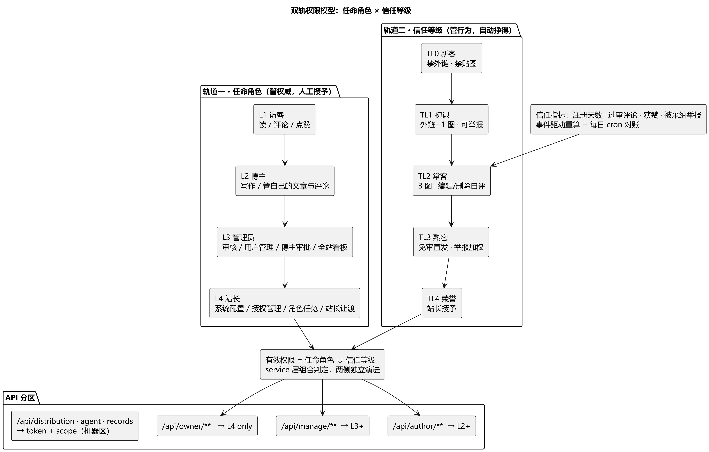

### 2.1 任命角色（轨道一：管权威，人工授予）

| 层级 | 角色 | 权限 |
|---|---|---|
| L1 | 访客 | 读全站、评论、点赞、评论图片（受信任等级闸门约束） |
| L2 | 博主 | L1 + 写作、管理**自己**的文章与自己文章下的评论、个人统计 |
| L3 | 管理员 | L2 + 全站评论审核、用户管理、博主审批、审核队列处理、全站看板 |
| L4 | 站长 | L3 + 系统配置、授权管理（token）、角色任免、站长让渡 |

### 2.2 信任等级（轨道二：管行为，自动挣得）

| 等级 | 达成条件（硬编码阈值） | 解锁能力 |
|---|---|---|
| TL0 新客 | 注册即得 | 评论纯文字；**禁外链、禁贴图** |
| TL1 初识 | 注册 ≥3 天 且 过审评论 ≥2 | 外链、贴图 ≤1 张、可举报 |
| TL2 常客 | 注册 ≥14 天 且 过审评论 ≥5 且 获赞 ≥3 | 贴图 ≤3 张、可编辑/删除自己的评论 |
| TL3 熟客 | 注册 ≥30 天 且 过审评论 ≥10 且 获赞 ≥10 且 被采纳举报 ≥1 | **评论免审直发**、举报权重提升 |
| TL4 荣誉 | 站长手动授予 | 荣誉标识 + 特权预留位 |

指标集（只收登录用户的四个可证实动作）：注册天数、过审评论数、获赞数、被采纳举报数。事件驱动重算 + 每日 cron 对账。阈值全部硬编码为常量，不配置化（防刷、防误配、可单测）。

### 2.3 机器身份（轨道三）

agent 通过 CLI 接入使用独立的机器身份，不复用人的会话：

| 项 | 设计 |
|---|---|
| 令牌 | `api_token` 表：名称、BCrypt 哈希、显示前缀、scopes、创建人、最近使用（时间+IP）、过期时间、吊销时间 |
| scope | `articles:read`（拉取待分发）/ `drafts:write`（agent 来稿）/ `records:write`（回填发布记录） |
| 签发 | 管理端操作；完整 token 仅展示一次，之后只显示 `ink_****abcd` |
| 吊销 | 一键吊销即时生效；CLI 收到 401 提示重新授权 |

### 2.4 双轨融合规则

**有效权限 = 任命角色 ∪ 信任等级 ∪（机器 scope）**。判定点分四层：SecurityConfig（URL 区）→ 数据库 role 字段（JWT 解析）→ service 层组合（角色 ∪ 信任）→ 数据级约束（作者只能操作自己的；站长不能禁用/删除/降级自己）。

API 分四区：

```
/api/author/**      → L2+（博主zone）
/api/manage/**      → L3+（管理zone）
/api/owner/**       → L4 only（站长zone）
/api/distribution/**·/api/agent/**·/api/publish-records → token + scope（机器区）
```

---

## 3. 功能需求


> 上图为**功能分解树**（系统 → 板块 → 模块 → 功能点），开题报告与论文第 4 章直接使用；下图为模块间数据流关系图。

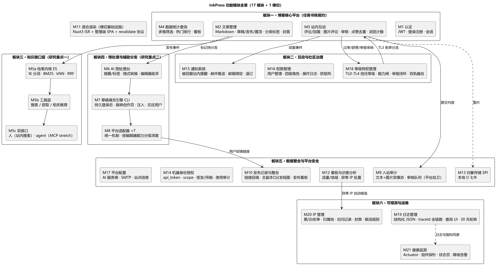

优先级定义：**P0** = 任务书铁契约与系统骨架（不可砍）；**P1** = 研究重点与核心差异（尽量保）；**P2** = 治理增强（工期紧时可降级演示，如权限先两级后四级）。

> 模块共 **21 个编号项：20 个功能模块 + 1 个横切基础设施（M11 混合渲染）**；M19 traceId 基础设施随 M1 同步落地（几乎零成本，全项目排查都受益）。

### 3.1 板块一 · 博客核心平台（P0）

| 模块 | 功能点 | 验收标准 |
|---|---|---|
| **M1 认证** | 注册/登录（BCrypt）、JWT（7 天）、双角色、越权拦截（401/403 业务码） | 无 token 访问管理区返回 401；访客访问 L3 接口返回 403 |
| **M2 文章管理** | Markdown 编辑、草稿/发布/下架/置顶、分类标签、封面、封面临时预览 | 草稿前台不可见（404）；发布后 ES 索引同步（≤2s） |
| **M3 站内互动** | 评论/回复（两级）、图片评论（≤3 张/≤5MB）、审核流、点赞去重（登录用户 ID + 游客 IP）、浏览计数（Redis 定时回写） | 重复点赞计数不变；待审核评论前台不可见；计数断网不丢（Redis 持久化） |
| **M4 数据统计查询** | 分类/标签/关键词/时间多维筛选、热门排行、看板（总量 + 趋势 + 分布） | 看板数字与库中一致；筛选组合正确 |

### 3.2 板块二 · 互动与社区治理

| 模块 | 优先级 | 功能点 | 验收标准 |
|---|---|---|---|
| **M15 通知系统** | P1 | 被回复站内提醒（铃铛+红点+已读）、评论审核结果通知、升级通知；邮件通道（SMTP 异步，重试 3 次降级）；邮箱绑定（验证邮件）；游客选填邮箱 + 频率限制 + 退订说明 | 邮件发送失败不影响评论主链路；退订后不再发送 |
| **M16 权限管理** | P2 | 用户管理（列表/禁用/重置密码/角色变更）、四级角色、操作日志（只增不改）、防锁死（不能动自己） | 角色变更留痕；禁用自己返回业务错误 |
| **M18 等级特权管理** | P2 | TL0-TL4 规则引擎（事件驱动 + cron 对账）、能力闸（TL0 禁图禁链）、举报系统（提交/队列/采纳/驳回/滥用防护）、等级徽章 + 进度 UI、管理端等级分布 | TL0 发图被拒并提示升级条件；举报采纳后信任分 +1；连续 5 次驳回禁举报 7 天 |

### 3.3 板块三 · 知识接口层（研究重点一，P1）

| 模块 | 功能点 | 验收标准 |
|---|---|---|
| **M5 知识接口层** | ① ES 检索内核：IK 中文分词 + BM25 + dense_vector kNN + RRF 混合；② 工具层：`search_articles` / `get_article` / `get_related`；③ 双接口：人的站内搜索 + 相关推荐；agent 的 MCP 只读工具（stretch） | 标注查询集 Top-1 命中率 ≥90%（BM25/kNN/混合三臂对比有数据）；ES 宕机时降级 MySQL LIKE 并记审计 |

**明确不做**：RAG 问答管道（固定 top-k + prompt stuffing + 引用幻觉 + 不可评估，四项死穴）。

### 3.4 板块四 · 预处理与辅助分发（研究重点二，P1）

| 模块 | 功能点 | 验收标准 |
|---|---|---|
| **M6 AI 预处理台** | 摘要/标签生成（服务端或编辑器内）、Markdown → 平台格式转换、编辑器 AI 助手 | 生成的摘要可编辑后保存；转换产物保留代码块与外链 |
| **M7 草稿填充引擎 CLI** | Node + TS + Playwright；持久化登录态（用户 profile）；跳转创作页、建草稿、注入标题/正文/图片/标签；**到点交还用户**；SQLite outbox 断网补发 | 断网后发布记录恢复网络自动补发；注入失败回退为“内容已复制到剪贴板”提示 |
| **M8 平台适配器 ×7** | 统一 SPI，按编辑器能力分级：**T1 深填**（掘金/CSDN/公众号，尽量注满）、**T2 半自动**（知乎/B站，注入后用户收尾）、**T3 格式转换**（小红书长图文/抖音口播稿，一键复制不碰自动化） | 每平台填充成功率有统计；选择器失效时 skill 重新探测，失败回退人工提示 |

**辅助式分发原则**：自动化只做机械劳动（跳转/建草稿/注入），审核与发布决定永远留给用户。目的是便利，不是全自动。

**审计边界**：出站合规提示 = 用户自理（CLI 可选功能，用户自己的 Key，附责任声明）；入站合规 = 平台自卫（见 M9）。

### 3.5 板块五 · 数据整合与平台安全

| 模块 | 优先级 | 功能点 | 验收标准 |
|---|---|---|---|
| **M9 入站审计** | P1 | 文本（启发式预筛 + LLM）+ 图片（人工审核队列，视觉预审 stretch）双模态；审核队列后台 | 命中可疑特征的评论不直接展示；审计记录含 risk 等级与处理人 |
| **M10 发布记录与整合** | P1 | 用户回填链接（CLI 辅助捕获）、主副本↔分发链接视图（文章页展示各平台同步链接）、发布看板 | 文章详情页展示全部分发链接；回填后即时可见 |
| **M12 看板与访客分析** | P2 | 流量/地域/设备统计、异常 IP 识别（频率/爬虫特征）与处置（限流/封禁） | 异常 IP 触发限流有审计记录 |
| **M13 对象存储 SPI** | P1 | 本地 ↔ 七牛 OSS 可插拔；URL 公网可达（平台编辑器要抓取） | 切换存储后端图片不失效（旧 URL 兼容期） |
| **M14 机器身份授权** | P1 | 见 2.3；管理端签发/列表/吊销 + 使用审计 | 吊销后 CLI 立即 401；使用日志可查 |
| **M17 平台配置** | P2 | AI 服务商（base-url/key/model，脱敏 + 测试连接）、SMTP、站点信息（名称/描述/头像——SEO meta 数据源） | 配置保存即时生效；密钥接口不返回明文 |

### 3.6 板块六 · 可观测与运维

| 模块 | 优先级 | 功能点 | 验收标准 |
|---|---|---|---|
| **M19 日志管理** | P1 | logback 结构化 JSON 日志；**traceId 全链路**（Nginx 生成 → 请求头 `X-Trace-Id` → MDC → 日志 → 错误响应体带回，用户报错贴一个 ID 即查全链）；管理端日志查询（级别/时间/模块/traceId 过滤分页）；按日轮转保留 30 天 | 任给 traceId 拉出全链日志；错误响应体含 traceId |
| **M20 IP 管理** | P2 | 黑/白名单（手动 + M12 异常检测自动候选）；IP 归属地（离线库）；访问记录查询（IP/时间/路径/UA）；封禁/解封（时长/原因/操作人留痕）；分接口限流规则配置 | 封禁后该 IP 立即 403；限流触发返回 429 且进审计 |
| **M21 健康监测** | P2 | Spring Boot Actuator（`/actuator/health` 含 MySQL/Redis/ES/SMTP 自定义 indicator）；管理端状态页（组件 up/down + 探测延迟、JVM 内存/GC、线程池饱和度、近 1h 请求量/错误率）；健康降级邮件告警（复用 M15） | 停掉 ES 容器后状态页显示 down 且检索降级；告警邮件到达 |

> 分工：M19 是**技术日志**（文件，服务排查），operation_log 是**业务审计**（DB，服务追溯）——两套并存，互不替代。

### 3.6 横切 · M11 混合渲染（P0）

Nuxt 3：内容页 ISR（SEO + agent 可读 + 内容热更新）、管理端 SPA（`ssr: false`）、revalidate 协议（见 6.4）。验收：文章页 view-source 含完整 HTML；发布后缓存 ≤5s 失效。

---

## 4. 关键业务流程（时序图集）

> 每张图标明三要素：**参与方与调用方向**（边界在哪）、**失败路径**（错了怎么走）、**状态落点**（数据写到哪）。排查问题时按图对链，不猜。

### 4.1 辅助分发链路（M7 / M8 / M10）——架构灵魂

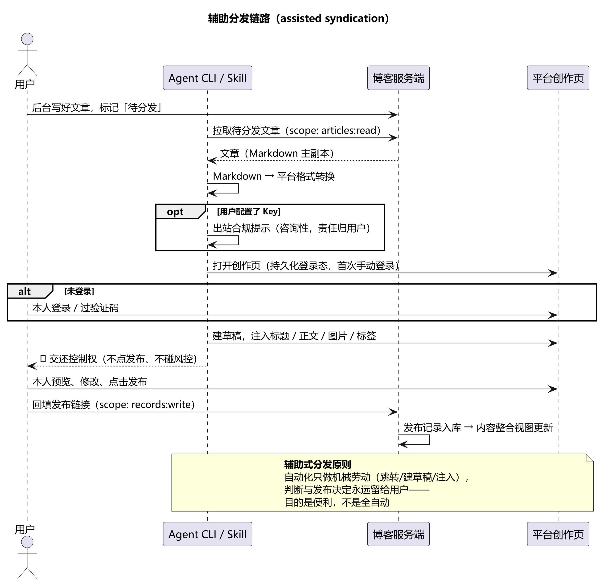

### 4.2 评论-信任闭环（M3 / M9 / M15 / M18）——治理引擎

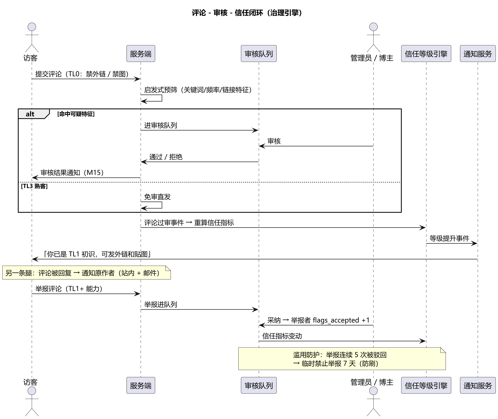

### 4.3 文章发布全链路（M2 / M5 / M11）——权威与投影

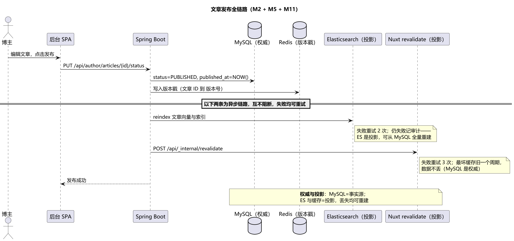

### 4.4 登录与双轨鉴权（M1 / M14）——入口

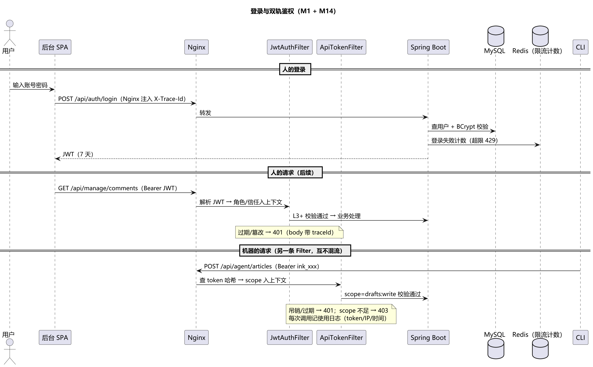

### 4.5 评论审核全流程（M3 / M9 / M15）——内容入口

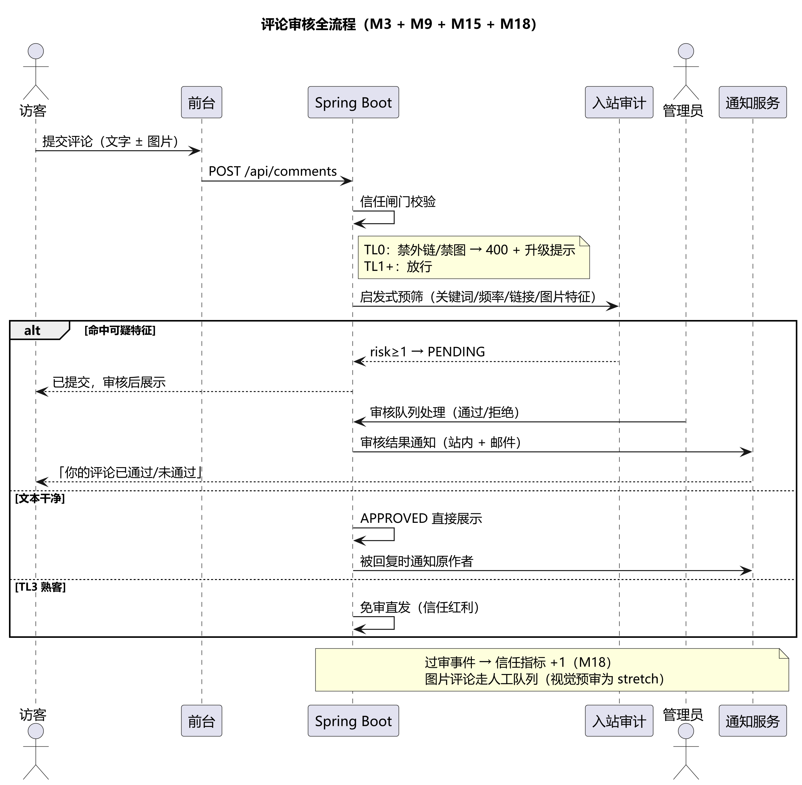

### 4.6 语义搜索混合检索（M5）——研究重点一

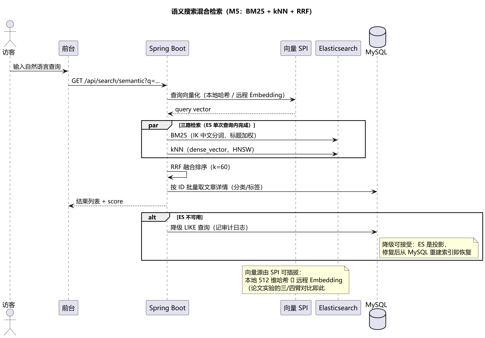

### 4.7 机器认证与 Agent 来稿（M14 / M9）——agent 入口

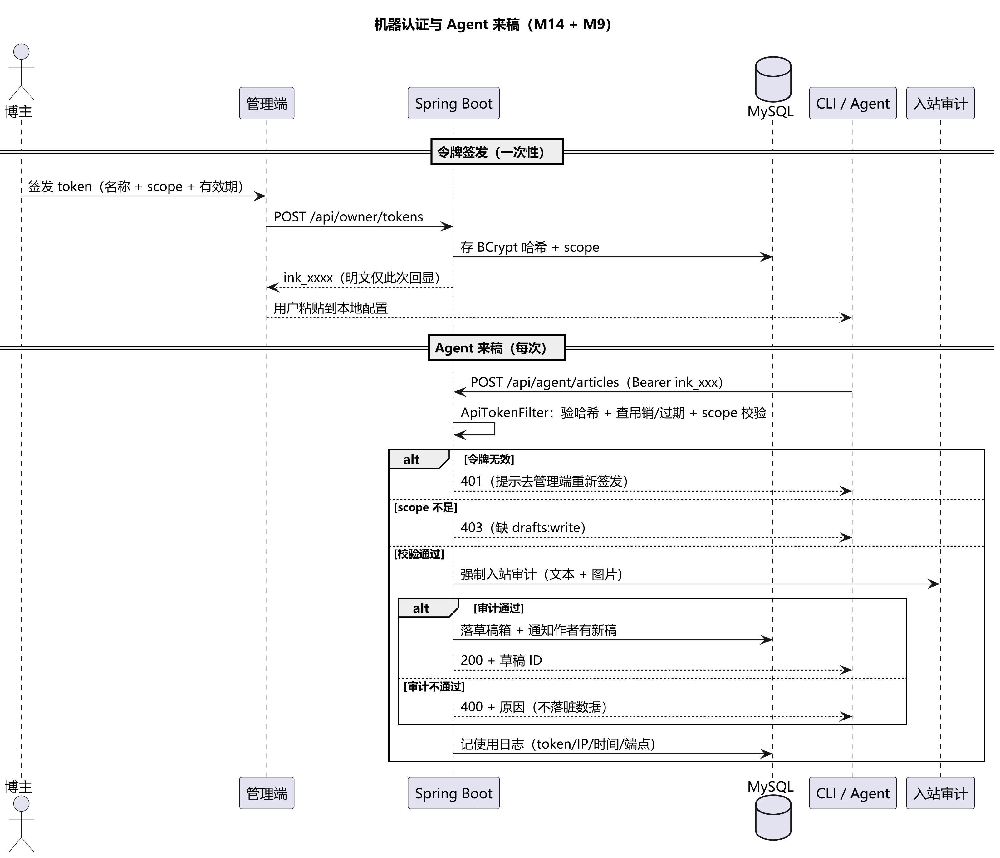

### 4.8 traceId 日志排查链路（M19）——排查主线

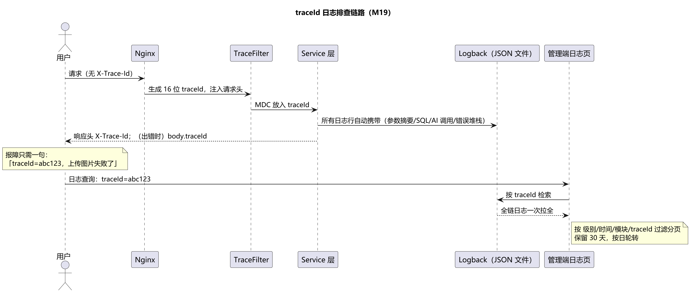

> 排查范式：用户报障 → 拿响应体里的 traceId → 管理端日志页一次拉出全链（请求参数 → service → SQL 摘要 → AI 调用 → 错误堆栈）→ 按上面任意一张时序图定位断点。

---

## 5. 系统架构

### 5.1 总体架构

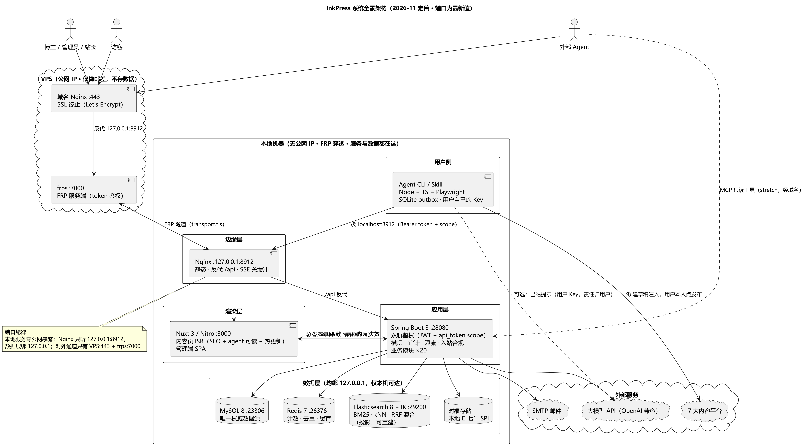

### 5.2 数据模型

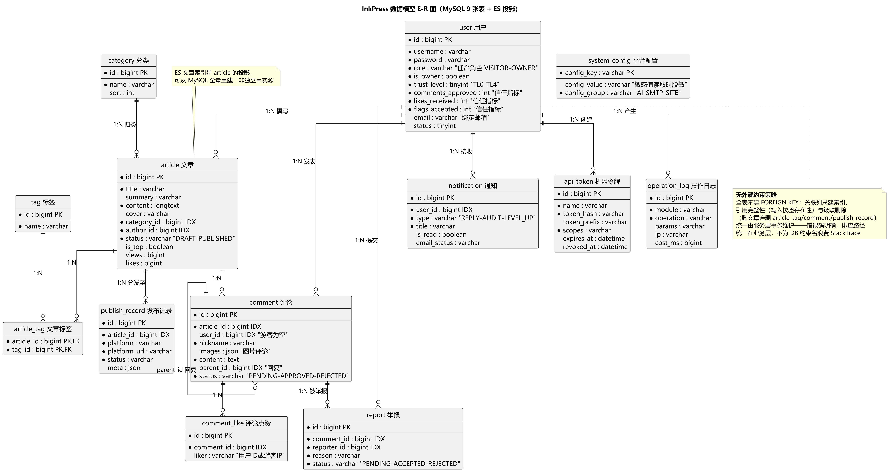

**无外键约束策略**：全表不建 `FOREIGN KEY`，关联列只建索引。引用完整性与级联删除统一由服务层维护：

| 场景 | 策略 |
|---|---|
| 写入关联 | service 校验关联存在性（如评论的 article_id 必须对应已发布文章） |
| 删除父实体 | service 先校验无引用（分类下有文章 → 拒绝，返回业务错误码“该分类下还有 3 篇文章”） |
| 级联删除 | service 同事务内删子记录（删文章 → article_tag/comment/comment_like/publish_record） |
| 索引 | 所有关联列建索引，查询性能不受影响，只是无约束 |

理由：① 错误码明确、提示友好（业务语言 vs DB 约束名）；② 排查路径统一在业务层，Stack trace 指向 service 而非 DB；③ 为分库分表预留；④ 避免 InnoDB 外键锁竞争。

**权威与投影原则**：MySQL 是唯一事实源；ES 文章索引是投影（可从 MySQL 全量重建）；Nuxt ISR 缓存是投影（可重新渲染）；CLI 本地 outbox 是暂存（补发后即清）。任何派生状态丢失都不影响事实。

### 5.3 技术栈

| 方面 | 选型 | 理由 |
|---|---|---|
| 前端 | Nuxt 3（Vue 3 + Vite + TS）+ Element Plus + ECharts + Pinia | 混合渲染一石三鸟：内容页 ISR 解决 SEO/agent 可读/热更新，管理端 SPA 控复杂度 |
| 后端 | Java 17 + Spring Boot 3.3 + Spring Security + MyBatis-Plus + jjwt 0.12 | 任务书指定生态；Knife4j 出 OpenAPI |
| 关系数据 | MySQL 8.0 | 任务书指定；唯一权威数据源 |
| 缓存 | Redis 7 | 计数/去重/缓存；向量移交 ES 后职责收窄 |
| 检索内核 | Elasticsearch 8.x + IK 中文分词 | BM25 + kNN + RRF 混合；工业级站内搜索 |
| 向量方案 | SPI：本地 bigram 特征哈希（512 维）↔ 远程 Embedding | 零依赖基线，配 Key 升级；两者对比即实验数据 |
| AI 接入 | OpenAI 兼容适配层（SPI） | 换厂商只改配置；服务端平台 Key、CLI 用户 Key，密钥边界分离 |
| CLI/Agent | Node + TypeScript + Playwright | 与前端同生态；auto-waiting 专治脆弱 DOM；持久化 context 保登录态 |
| Skill 自适应 | Playwright MCP + AI 探索定位 | 平台改版重新探测选择器，失败回退人工提示 |
| 本地可靠性 | SQLite outbox | CLI 断网发布记录本地排队，恢复后至少一次补发 |
| 认证 | JWT（人）+ api_token + scope（机器） | 人的会话与机器身份分离，最小权限 |
| 契约 | OpenAPI → TS client 单向生成 | 根治前后端类型漂移 |
| 通知 | 站内轮询（30s）+ SMTP 异步 | 邮件失败降级不影响主链路 |
| 存储 | 对象存储 SPI（本地/七牛） | 评论图片→封面→分发取图，一条链一个接口 |
| 部署 | Docker Compose 六容器 + Nginx + FRP | 见第 8 节 |

---

## 6. 接口与集成约定

### 6.1 API 分区与认证

见 2.4。人的请求走 `Authorization: Bearer <JWT>`；机器请求走 `Authorization: Bearer ink_<token>`。两个 Filter 并列，互不混流。

### 6.2 scope 定义

| scope | 允许访问 |
|---|---|
| `articles:read` | GET /api/distribution/pending（拉取待分发文章） |
| `drafts:write` | POST /api/agent/articles（agent 来稿，强制入站审计） |
| `records:write` | POST /api/publish-records（回填发布记录） |

### 6.3 前后端契约

Knife4j 输出 OpenAPI spec → 生成 TS client（`inkpress-web/src/api/generated/`），Nuxt 服务端取数复用同一 client。Java DTO 变更 → spec 变更 → client 重新生成，写进 CI 检查（spec 与 client 不一致即构建失败）。

### 6.4 revalidate 协议（Spring Boot → Nuxt）

```
POST /api/_internal/revalidate
Header: X-Internal-Secret: <shared secret>
Body: { "routes": ["/article/123", "/", "/archive"], "reason": "ARTICLE_PUBLISHED" }
```

失败重试 3 次，最终失败记审计日志。最坏结果是缓存多存活一个周期（数据不丢，只是旧），可接受。

### 6.5 traceId 规范（全链路排查）

1. Nginx 生成或透传请求头 `X-Trace-Id`（无则生成 16 位短码）
2. Spring Filter 放入 MDC，所有日志行自动携带
3. 响应头返回 `X-Trace-Id`；错误响应体 `data.traceId` 同步带回
4. CLI 调用同样携带——用户报障时贴一个 ID，服务端全链日志（请求/参数/SQL 摘要/AI 调用/错误）一次拉全

### 6.5 边界闭合原则

1. **每份状态有且只有一个权威方**（MySQL 事实、ES 投影、Nuxt 缓存、outbox 暂存）；
2. **每根箭头都有显式契约**（API schema / 事件载荷 / scope 令牌）；
3. **每个派生状态都能从权威方重建**。

---

## 7. 非功能需求

| 维度 | 指标 |
|---|---|
| 性能 | 公开页首屏 ≤1.5s（ISR 缓存命中）；语义搜索 p95 ≤400ms（38 篇量级）；AI 流式首 token ≤3s |
| 安全 | 全站 HTTPS（VPS 终止）；密码 BCrypt；token BCrypt 哈希存储；SQL 参数化；XSS 白名单净化；提示注入检测 + 审计；登录/AI 接口 IP 限流 |
| 隐私 | 访客分析只到 IP 粒度与聚合行为，不采集个人身份信息；隐私声明页；邮件退订；ES/日志不落明文密钥 |
| 可用性 | 家庭网络故障 = 站点下线（诚实声明，演示走 localhost:8912）；ES 宕机检索降级 MySQL；邮件失败评论主链路不受影响 |
| 容量 | 个人博客百篇量级；ES 单节点 heap 512M；MySQL/Redis 单容器 |

---

## 8. 部署方案

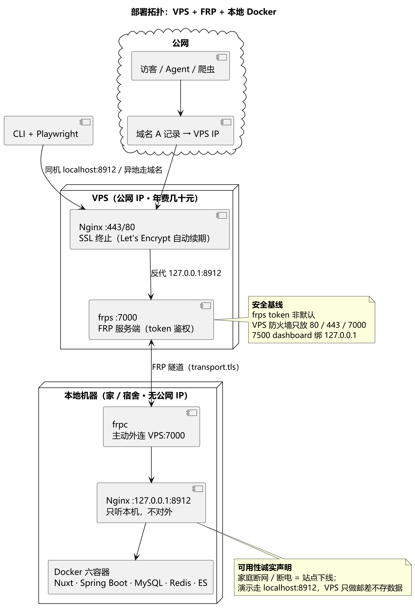

### 8.1 容器与端口

| 服务 | 容器内端口 | 宿主机绑定 | 可达范围 |
|---|---|---|---|
| Nginx（本地） | 80 | **127.0.0.1:8912** | 只听本机——对外通道是 FRP |
| frpc | — | 出站连接 | 主动连 VPS:7000，穿透 NAT |
| MySQL | 3306 | 127.0.0.1:23306 | 仅本机工具 |
| Redis | 6379 | 127.0.0.1:26376 | 仅本机 |
| Elasticsearch | 9200 | 127.0.0.1:29200 | 仅本机（调试） |
| VPS Nginx | 80/443 | 0.0.0.0:80/443 | **真正的公网入口** |
| frps | 7000 | 0.0.0.0:7000 | 收 frpc 连接 |

Nuxt（容器内 3000）与 Spring Boot（容器内 28080）**不映射宿主机端口**——生产藏 Nginx 后，开发期宿主机直跑（25173/28080）。

### 8.2 FRP 隧道

- SSL 终止在 VPS Nginx（Let's Encrypt + certbot 自动续期）；隧道内部走 frp `transport.tls`
- 本地 Nginx 只听 127.0.0.1:8912，frpc 从本机连它——**本地服务零公网暴露**
- SSE 流式经隧道原样穿过（TCP 隧道，注意 frpc 侧勿设短 idle 超时）

### 8.3 安全基线

1. frps token 非默认值；VPS 防火墙只放 80/443/7000；7500 dashboard 绑 127.0.0.1
2. `.env`（含 AI Key、SMTP 授权码、JWT secret、frp token）gitignore，永不入库
3. 部署文档单列“安全基线”小节，上线前逐项核对

---

## 9. 工程纪律（项目法律）

1. **完成的定义（DoD）**：代码 + 单元测试 + 契约测试 + 端到端手验 + 文档注记，五样齐才算做完一个模块
2. **回归脊柱**：每模块测试进套件，每次改动全量跑（`mvn test` / vitest / jest），不允许跳过
3. **契约测试**：第 6 节每条边界至少 1 个测试，**含失败路径**（ES 挂、revalidate 失败、断网补发、选择器失效回退）
4. **禁“待验证”**：开发时必须真验——AI 功能开发时即用真 Key 验完，不留“待配置”尾巴
5. **BUG 账**：发现即记录（现象/根因/修复/回归测试编号），修复以回归测试通过为准
6. **主分支永远可演示**：模块完成即入主，不做长期破烂分支

---

## 10. 里程碑（对齐任务书窗口）

| 周次 | 时间 | 阶段 | 交付 |
|---|---|---|---|
| 1-4 | 2026.11 | 调研与开题 | 本 PRD 定稿、开题报告成文与答辩 |
| 5-8 | 2026.12 | 分析与设计 | 需求规格说明书、数据库设计、架构设计、环境搭建（六容器 + ES/IK） |
| 9-16 | 2027.01-02 | 编码实现 | P0 全部 → P1 全部 → P2（可降级）；中期检查 |
| 17-20 | 2027.03 | 联调与测试 | 填充成功率/检索命中率/性能测试、论文初稿 |
| 21-24 | 2027.04 | 定稿 | 论文修改、查重、材料整理 |
| 25-26 | 2027.05 | 答辩 | PPT、预演、正式答辩 |

实现顺序（依赖驱动）：环境+init.sql → M1（含 M19 traceId 基础设施）→ M2 → M4 → M3 → M11 → M13 → M9 → M5 → M15 → M14 → M6 → M7 → M8 → M10 → M17 → M16 → M12+M20 → M18 → M21 → M19 查询 UI。

---

## 11. 风险与开放问题

| # | 事项 | 状态 |
|---|---|---|
| 1 | 微信公众号未认证个人号的 API 权限（草稿/发布接口是否开放） | **开放**——实现前查微信公众平台当期文档，决定走 API 还是浏览器 |
| 2 | 各平台创作页的选择器与反自动化强度 | 开放——按 T1/T2/T3 分级落地，先掘金后公众号 |
| 3 | 家庭网络可用性（演示与答辩当天） | 已决策——演示走 localhost:8912，论文写诚实声明 |
| 4 | M16/M18 工期风险 | 已决策——P2，可降级为先两级角色后四级 |
| 5 | MCP 接口、CDN 全量加速、视觉预审、完整访客等级 | Stretch——有余力才做，不影响主链路 |
| 6 | ES 版本与 Spring Data Elasticsearch 客户端兼容矩阵 | 开放——选型时查证，IK 插件版本严格对齐 |

---

*本文档是重建期唯一设计基准；变更须走“提出 → 影响面分析 → 文档更新 → 回归测试补充”四步，禁止口头改设计。*
