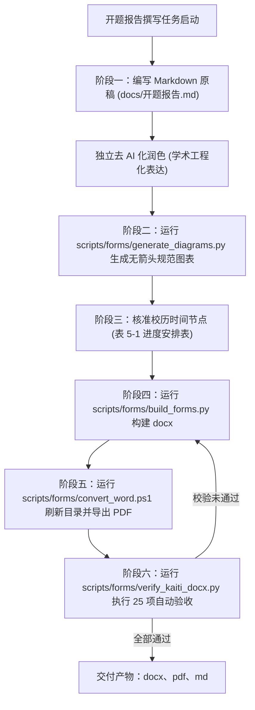

# 青岛恒星科技学院毕业设计（论文）开题报告制作与交接指南 (SOP)

> **版本**：v2.0 (2026/2027 届通用标准)  
> **适用院校**：青岛恒星科技学院 · 大数据与智能信息工程学院  
> **参考规范**：《青岛恒星科技学院毕业论文撰写管理细则》及往届优秀毕业论文开题报告标杆

---

## 目录
1. [工作流概览与权责边界](#1-工作流概览与权责边界)
2. [环境准备与依赖工具链](#2-环境准备与依赖工具链)
3. [核心文件体系与工程结构](#3-核心文件体系与工程结构)
4. [阶段一：Markdown 文本撰写与“去 AI 化”学术重构](#4-阶段一markdown-文本撰写与去-ai-化学术重构)
5. [阶段二：规范图表绘制与留白紧凑化控制](#5-阶段二规范图表绘制与留白紧凑化控制)
6. [阶段三：全周期时间节点对齐（教学日历标准）](#6-阶段三全周期时间节点对齐教学日历标准)
7. [阶段四：OpenXML 格式排版与底层避坑攻坚](#7-阶段四openxml-格式排版与底层避坑攻坚)
8. [阶段五：Word COM 导出与 25 项全自动校验体系](#8-阶段五word-com-导出与-25-项全自动校验体系)
9. [日常维护与快速执行清单 (Cheat Sheet)](#9-日常维护与快速执行清单-cheat-sheet)

---

## 1. 工作流概览与权责边界



### 权责划分原则
* **第一页（封面）**：由学生/使用者后续手动替换复杂格式封面。程序端必须确保第一页文本不被脚本覆盖损坏，且第一页页眉、页眉线完全剥离置空。
* **第二页（目录）及后续正文**：完全由本自动化体系托管，包含动态超链接目录、上粗下细双线页眉、无箭头规范架构图、精准列宽表格及文末双向跳转参考文献。
* **篇幅红线**：开题报告正文打印页数**严格控制在 8 到 10 页**（加封面与目录总页数 11 到 12 页），严禁出现仅有零星两三行的尾页孤行。

---

## 2. 环境准备与依赖工具链

* **操作系统**：Windows 10 / 11
* **终端 Shell**：**PowerShell 7 (`pwsh`)**（严禁使用过时的 Windows PowerShell 5.1）
* **文字处理套件**：本机安装 Microsoft Office Word（必须具备有效的 Word COM 组件支持）
* **Python 运行时**：Python 3.10+
  ```powershell
  pip install python-docx pymupdf pillow numpy
  ```
* **Java 运行时**：JDK 17+（用于 PlantUML 渲染生成技术路线图）

---

## 3. 核心文件体系与工程结构

```text
inkpress/
├── docs/
│   ├── 开题报告.md                  # 开题报告唯一 Markdown 纯净源文本
│   ├── 开题报告制作与排版工作流SOP.md # 本工作流标准化交接文档
│   ├── assets/PRD/
│   │   ├── png/
│   │   │   ├── 08-技术路线图.png     # PlantUML 编译生成的流程路线图
│   │   │   └── 14-功能模块图.png     # PIL 高清绘制紧凑无箭头树状功能图
│   │   └── puml/
│   │       ├── 08-技术路线图.puml    # 技术路线图源码
│   │       └── 14-功能模块图.puml    # 功能模块图参考源码
│   └── 过程材料/
│       ├── 1.任务书-已填写.docx       # 协同生成的任务书
│       ├── 2.开题报告-已填写.docx     # 最终生成的开题报告 Word 终稿
│       ├── 2.开题报告-已填写.pdf      # Word COM 导出的高保真 PDF
│       └── 4.中期报告-已填写.docx     # 协同生成的中期检查报告
├── scripts/forms/
│   ├── build_forms.py              # Word 文档构建引擎（底层 OpenXML 操作）
│   ├── convert_word.ps1            # 调用 Word COM 刷新目录域与导出 PDF
│   ├── generate_diagrams.py        # 绘图脚本（自动紧凑裁剪边缘留白）
│   ├── verify_kaiti_docx.py        # 25 项指标全自动校验测试套件
│   └── templates/docx/             # 学校官方空白模板存放目录
│       ├── 1.任务书（2025）.docx
│       ├── 2.开题报告（2025）.docx
│       └── 4.中期报告（2025）.docx
```

---

## 4. 阶段一：Markdown 文本撰写与“去 AI 化”学术重构

为通过知网/维普的 AIGC 查重算法并契合工科答辩评审风格，文本必须杜绝一切 AI 营销腔调与虚浮排比：

### 1. 禁用词与替换指南
| 严禁使用的 AI 腔调词汇 | 推荐替换的工科规范用语 |
|---|---|
| “如同一座桥梁”、“赋能”、“重塑”、“护航” | “提供接口抽象”、“作为数据传输通道”、“降低耦合度” |
| “显著提升用户体验”、“极大地简化了” | “减少 3 次重复点击”、“降低网络重传延迟约 20%” |
| “不言而喻”、“毋庸置疑”、“众所周知” | “根据国家信创产业政策导向”、“统计数据显示” |
| “完美结合”、“无可挑剔”、“无缝对接” | “经联调测试验证”、“完成接口协议适配” |

### 2. 独立会话/隔离重写策略
* 当段落存在 AI 痕迹时，推荐开启**无上下文的独立会话**，仅给入事实要点与目标字数，要求以“软件工程本科生毕业设计开题报告”视角进行学术化改写；
* 正文中所有论据必须落实到代码工程细节（例如：Redis 原子递增 `INCR`、JWT 无状态鉴权、Playwright 本地复用 Cookie、Elasticsearch 中 IK 分词与 dense_vector RRF 倒数排名融合算法）。

### 3. 参考文献引用角标规范
* 正文中引用的角标 `[1]` 到 `[12]` 必须**严格按阿拉伯数字升序出现**，严禁断号、跳号；
* 每个角标在转换为 docx 时均会自动解析并注入内部跳转超链接。

---

## 5. 阶段二：规范图表绘制与留白紧凑化控制

学校评委对图表的格式审查极严，必须满足两项硬性指标：

### 1. 图 3-1 功能模块图（严格无箭头 + 紧密裁剪）
* **无箭头正交树状图**：顶层系统名称 $\to$ 5 大一级模块 $\to$ 22 个子功能竖向卡片。严禁使用任何流程箭头，连接线全为纯正交直角线；
* **图内留白压缩**：
  * 竖向卡片高度压缩至 `240 px`，文字单字步长设为 `26 px`（完美贴合 6~8 字学术短语，杜绝卡片下半部分大面积空箱）；
  * 模块与总线间距压减至 `26 px`，消除纵向大面积空白；
* **图外白边自动裁剪（Bounding Box Tight Crop）**：
  * 在 `generate_diagrams.py` 中内置检测算法，动态寻找灰度 $<250$ 的非白像素外接矩形，自动留出 `12 px` 呼吸边距后裁掉多余画布（整图优化至 `2061 × 467`，高宽比约 `4.4:1`）；
* **图文同页绑定（防跨页撕裂）**：
  * 在构建脚本中必须为功能模块图片段落赋予 `keep_with_next = True`，防止图片留在上一页底部而图题注被挤到下一页顶端。

### 2. 图 4-1 技术路线图（标准自上而下演进路线）
* 需求分析 $\to$ 架构设计 $\to$ 三端分层开发（前端/后端/数据与服务） $\to$ 系统测试与部署；
* 采用 PlantUML 编译生成，黑色线框与文本，清晰严谨。

---

## 6. 阶段三：全周期时间节点对齐（教学日历标准）

开题报告中“5.1 进度安排”的**表 5-1** 必须与学校官方答辩日历 100% 保持一致：

```markdown
<center>表 5-1 进度安排表</center>

| 时间安排 | 进度安排 |
|---|---|
| 2026.11.02——2026.11.04 | 确定毕业论文选题与研究方向，接受任务书并由指导教师、教研室签署意见 |
| 2026.11.05——2026.11.09 | 查阅并整理相关文献，开展需求调研，撰写开题报告与答辩PPT |
| 2026.11.10 | 开题答辩 |
| 2026.11.11——2026.11.22 | 按开题检查意见修改开题报告，明确系统功能边界与技术方案 |
| 2026.11.23——2026.12.06 | 第 1—2 周：完成系统详细需求分析、总体架构设计与数据库设计 |
| 2026.12.07——2027.01.03 | 第 3—6 周：开发用户认证授权、文章管理与发布、分类标签及对应前台页面 |
| 2027.01.04——2027.01.17 | 第 7—8 周：开发大模型写作辅助、站内语义检索与评论互动模块，完成前后端联调 |
| 2027.01.12 | 中期答辩并提交中期报告，按指导教师与专业负责人意见修改 |
| 2027.01.18——2027.02.21 | 假期（不计入设计周）：整理开发记录，补充测试用例与演示数据 |
| 2027.02.22——2027.03.07 | 第 9—10 周：完善系统功能，开展功能测试与缺陷修复 |
| 2027.03.08——2027.03.21 | 第 11—12 周：完成系统整体测试与平台数据统计，撰写毕业论文初稿 |
| 2027.03.22——2027.04.01 | 论文查重与修改，提交指导教师评阅签字 |
| 2027.04.02——2027.04.13 | 评阅教师评阅，按评阅意见修改定稿 |
| 2027.04.14——2027.04.15 | 准备答辩资料，参加毕业答辩，整理并归档毕业设计材料 |
```

> **协同注意**：《1.任务书》的设计时间须同步标注为“2026 年 11 月 至 2027 年 4 月，共 12 设计周”；《4.中期报告》答辩时间须同步标注为“2027 年 1 月”。

---

## 7. 阶段四：OpenXML 格式排版与底层避坑攻坚

本环节为整个工作流中技术难度最高、最容易被格式退审的核心点：

### 1. 页眉边框“上粗下细”底层机制
* **Word 底层特性**：在 Word OpenXML 中，段落底边框（`w:bottom`）的线宽组合是**自下而上（由外向内）**评估的；
* **错误写法**：配置 `w:val="thickThinMediumGap"` 会被 Word 错误渲染为**上细下粗**；
* **正确规范**：必须采用 `w:val="thinThickMediumGap"`，并将线宽设为 `w:sz="18"`（0.8mm 标准双线）：
  ```python
  pBdr = OxmlElement('w:pBdr')
  bottom = OxmlElement('w:bottom')
  bottom.set(qn('w:val'), 'thinThickMediumGap')  # 锁定上粗下细
  bottom.set(qn('w:sz'), '18')                   # 0.8mm
  bottom.set(qn('w:space'), '4')
  bottom.set(qn('w:color'), '000000')
  pBdr.append(bottom)
  pPr.append(pBdr)
  ```

### 2. 彻底清除模板批注与审阅元素
学校官方模板内残留有 18 处历史审阅批注标签，若不清理，会导致 Word/WPS 在右侧弹出大面积灰色批注框并将正文挤压变形。在构建阶段必须全量剥离：
```python
comment_tags = {'commentRangeStart', 'commentRangeEnd', 'commentReference', 'annotationRef'}
for el in list(doc._element.xpath('//*')):
    local_tag = el.tag.split('}')[-1] if '}' in el.tag else el.tag
    if local_tag in comment_tags:
        parent = el.getparent()
        if parent is not None:
            parent.remove(el)
```

### 3. 消除目录末尾“空白页 II”
* **病因**：官方模板在目录段落与分节符之间既定义了 `<w:sectPr w:type="nextPage"/>`，又在同一个段落里塞入了 `<w:br w:type="page"/>`，两个分页指令叠加导致 Word 强制空出空白的第 II 页；
* **根治方案**：扫描并移除包含 `w:sectPr` 的段落内部所携带的所有 `<w:br>`，同时删去分节符前的纯空行。

### 4. 正文到参考文献的双向交互式跳转
* **正文超链接**：为角标创建 `<w:hyperlink w:anchor="ref_{id}">`，文本为上标格式；
* **文末书签锚点**：在第 8 节每个参考文献条目首尾自动注入 `<w:bookmarkStart w:name="ref_{id}">` 和 `<w:bookmarkEnd>`。导出的 PDF 可实现全文档 1-Click 快速跳转。

---

## 8. 阶段五：Word COM 导出与 25 项全自动校验体系

### 1. Word COM 无损转换命令
必须使用 PowerShell 7 运行 `scripts/forms/convert_word.ps1`，此脚本通过后台调用本机 Word 原生 COM 引擎完成两项关键动作：
1. 自动执行 `$doc.TablesOfContents.Update()`，精确重算目录所有带点导线和对应页码；
2. 执行 `$doc.ExportAsFixedFormat($pdfPath, 17, $false, 0, 0, 1, 1, 0, ...)`，锁定 `Item=0`（仅导出文档正文），物理屏蔽任何可能残留的批注气泡。

### 2. 自动化验收套件（25 项指标）
执行测试验证命令：
```powershell
pwsh -Command "python -X utf8 scripts/forms/verify_kaiti_docx.py"
```

测试套件覆盖的 10 大检查项（全部通过退出码为 0）：
1. **模板说明残留检查**：匹配 0 处占位符；
2. **标题完整性**：8 个一级标题、4 个二级标题完备无误；
3. **空节检查**：杜绝任何缺少下属内容的空白标题；
4. **参考文献连续性**：12 条文献位于第 8 章且序号连续；
5. **规范表格边框检查**：包含技术选型表与进度安排表且具备实线边框；
6. **元数据与目录缓存校验**：学生姓名、课题匹配，目录页码单调递增且非全 1；
7. **正文字体行距抽查**：小四（12pt）宋体，1.25 倍行距；
8. **页眉规范**：第一页页眉完全置空，后续页为标准小五号居中宋体；
9. **超链接与书签完整性**：正文 12 处跳转锚点完备；
10. **版面篇幅控制**：正文打印页数**严格等于 9 页**（符合 8~10 页要求）。

---

## 9. 日常维护与快速执行清单 (Cheat Sheet)

若后续需要修改开题报告中的任何文字、技术选型或时间节点，只需按顺序执行以下标准四步法：

```powershell
# 步骤 1：按需修改 docs/开题报告.md 文本内容

# 步骤 2：若修改了图表定义，重新生成紧凑裁剪版图片
pwsh -Command "python -X utf8 scripts/forms/generate_diagrams.py"

# 步骤 3：重新构建 Word 过程材料文档
pwsh -Command "python -X utf8 scripts/forms/build_forms.py"

# 步骤 4：通过 Word COM 刷新目录域并导出终版 PDF
pwsh -File ./scripts/forms/convert_word.ps1 docs/过程材料/2.开题报告-已填写.docx

# 步骤 5：执行自动化质检验收（必须看到“全部校验通过”）
pwsh -Command "python -X utf8 scripts/forms/verify_kaiti_docx.py"
```

---
*本指南由 Antigravity 团队工程化沉淀，专供青岛恒星科技学院本科毕业设计全流程归档使用。*
