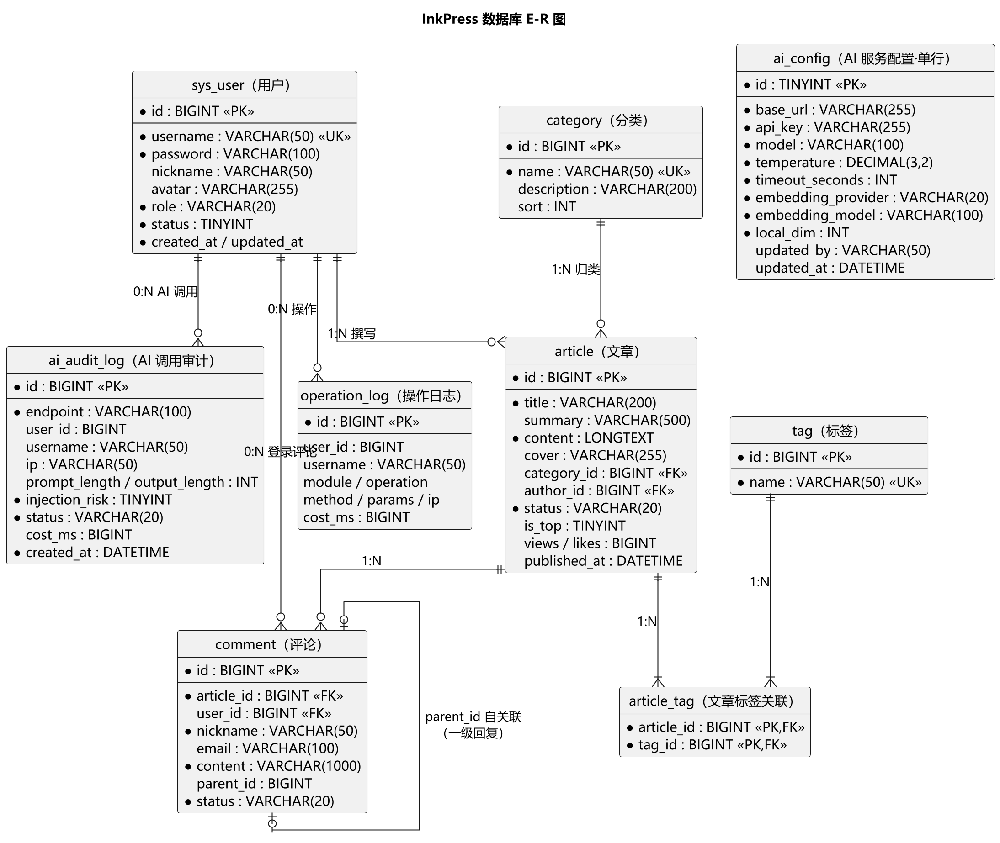

# InkPress 数据库设计

数据库名：`inkpress`，字符集 `utf8mb4`，引擎 InnoDB。建表脚本见 `inkpress-server/src/main/resources/db/init.sql`。

## 一、E-R 概述

实体及联系：

- **用户（sys_user）** 1 — N **文章（article）**（作者）
- **分类（category）** 1 — N **文章**
- **文章** M — N **标签（tag）**（通过关联表 article_tag）
- **文章** 1 — N **评论（comment）**；评论可自关联（parent_id）形成一层回复
- **用户** 1 — N **操作日志（operation_log）**

## 二、表结构

### 1. sys_user 用户表

| 字段 | 类型 | 约束 | 说明 |
|------|------|------|------|
| id | BIGINT | PK, 自增 | 用户 ID |
| username | VARCHAR(50) | NOT NULL, UNIQUE | 用户名 |
| password | VARCHAR(100) | NOT NULL | BCrypt 密文 |
| nickname | VARCHAR(50) | | 昵称 |
| avatar | VARCHAR(255) | | 头像 URL |
| role | VARCHAR(20) | NOT NULL, DEFAULT 'USER' | ADMIN / USER |
| status | TINYINT | NOT NULL, DEFAULT 1 | 1 正常 0 禁用 |
| created_at / updated_at | DATETIME | NOT NULL | 创建 / 更新时间 |

### 2. article 文章表

| 字段 | 类型 | 约束 | 说明 |
|------|------|------|------|
| id | BIGINT | PK, 自增 | 文章 ID |
| title | VARCHAR(200) | NOT NULL | 标题 |
| summary | VARCHAR(500) | | 摘要（可由 AI 生成） |
| content | LONGTEXT | NOT NULL | Markdown 正文 |
| cover | VARCHAR(255) | | 封面图 URL |
| category_id | BIGINT | 索引 | 分类 ID |
| author_id | BIGINT | | 作者 ID |
| status | VARCHAR(20) | NOT NULL, DEFAULT 'DRAFT', 索引 | DRAFT / PUBLISHED |
| is_top | TINYINT | NOT NULL, DEFAULT 0 | 是否置顶 |
| views | BIGINT | NOT NULL, DEFAULT 0 | 浏览量（Redis 批量回写） |
| likes | BIGINT | NOT NULL, DEFAULT 0 | 点赞数 |
| created_at / updated_at | DATETIME | NOT NULL | |
| published_at | DATETIME | 索引 | 发布时间 |

### 3. category 分类表

| 字段 | 类型 | 约束 | 说明 |
|------|------|------|------|
| id | BIGINT | PK, 自增 | |
| name | VARCHAR(50) | NOT NULL, UNIQUE | 分类名 |
| description | VARCHAR(200) | | 描述 |
| sort | INT | NOT NULL, DEFAULT 0 | 排序值 |

### 4. tag 标签表

| 字段 | 类型 | 约束 | 说明 |
|------|------|------|------|
| id | BIGINT | PK, 自增 | |
| name | VARCHAR(50) | NOT NULL, UNIQUE | 标签名 |
| created_at | DATETIME | NOT NULL | |

### 5. article_tag 文章标签关联表

| 字段 | 类型 | 说明 |
|------|------|------|
| article_id | BIGINT | 联合主键，文章 ID |
| tag_id | BIGINT | 联合主键，标签 ID，索引 |

### 6. comment 评论表

| 字段 | 类型 | 约束 | 说明 |
|------|------|------|------|
| id | BIGINT | PK, 自增 | |
| article_id | BIGINT | NOT NULL, 联合索引 | 所属文章 |
| user_id | BIGINT | | 登录用户 ID（游客为空） |
| nickname | VARCHAR(50) | NOT NULL | 昵称 |
| email | VARCHAR(100) | | 游客邮箱（选填） |
| content | VARCHAR(1000) | NOT NULL | 内容 |
| parent_id | BIGINT | | 父评论 ID（一级回复） |
| status | VARCHAR(20) | NOT NULL, 联合索引 | PENDING / APPROVED / REJECTED |
| created_at | DATETIME | NOT NULL | |

### 7. operation_log 操作日志表

| 字段 | 类型 | 说明 |
|------|------|------|
| id | BIGINT | PK, 自增 |
| user_id / username | BIGINT / VARCHAR(50) | 操作人 |
| module / operation | VARCHAR(50) / VARCHAR(100) | 模块与操作名 |
| method | VARCHAR(200) | 请求方式 + 路径 |
| params | VARCHAR(2000) | 参数 JSON（截断） |
| ip | VARCHAR(50) | 来源 IP |
| cost_ms | BIGINT | 耗时（毫秒） |
| created_at | DATETIME | 时间，索引 |

### 8. ai_audit_log AI 调用审计表

| 字段 | 类型 | 约束 | 说明 |
|------|------|------|------|
| id | BIGINT | PK, 自增 | |
| endpoint | VARCHAR(100) | NOT NULL | AI 调用端点 |
| user_id / username | BIGINT / VARCHAR(50) | | 调用人（游客为 anonymous） |
| ip | VARCHAR(50) | | 来源 IP |
| prompt_length | INT | | 输入长度 |
| injection_risk | TINYINT | NOT NULL, DEFAULT 0, 索引 | 提示注入风险 0/1/2 |
| status | VARCHAR(20) | NOT NULL, 索引 | OK / TIMEOUT / ERROR / RATE_LIMITED |
| output_length | INT | | 输出长度 |
| cost_ms | BIGINT | | 耗时（毫秒） |
| created_at | DATETIME | NOT NULL, 联合索引 | 调用时间 |

### 9. ai_config AI 服务配置表（单行）

| 字段 | 类型 | 约束 | 说明 |
|------|------|------|------|
| id | TINYINT | PK，固定为 1 | 单行配置 |
| base_url | VARCHAR(255) | NOT NULL | OpenAI 兼容协议地址 |
| api_key | VARCHAR(255) | NOT NULL, DEFAULT '' | API 密钥（接口返回时脱敏） |
| model | VARCHAR(100) | NOT NULL | 对话模型名 |
| temperature | DECIMAL(3,2) | NOT NULL, DEFAULT 0.70 | 采样温度 |
| timeout_seconds | INT | NOT NULL, DEFAULT 60 | 调用超时 |
| embedding_provider | VARCHAR(20) | NOT NULL, DEFAULT 'auto' | auto / local / remote |
| embedding_model | VARCHAR(100) | NOT NULL, DEFAULT 'embedding-3' | 远程向量模型名 |
| local_dim | INT | NOT NULL, DEFAULT 512 | 本地向量维度 |
| updated_by | VARCHAR(50) | | 最后修改人 |
| updated_at | DATETIME | ON UPDATE | 修改时间 |

## 三、设计要点

1. **浏览量高频写入**：浏览量先在 Redis 中 `INCR`，定时任务每分钟批量回写 MySQL，避免每次浏览都写库；点赞数采用 Redis Set 记录"谁点过"实现同人去重，计数直接落库。
2. **多对多关系**：文章与标签通过 article_tag 关联表解耦，标签可复用、可统计。
3. **评论审核流**：状态机 PENDING → APPROVED / REJECTED，前台只展示 APPROVED。
4. **软性约束**：分类/标签删除前在业务层校验是否仍被文章引用，避免脏数据（应用层完整性校验，替代外键级联）。
5. **索引设计**：status、category_id、published_at、(article_id, status) 等高频查询条件均建索引。
6. **AI 配置单行表与优先级解析**：ai_config 固定一行，管理端保存即创建、恢复默认即删除。解析顺序为数据库 → 环境变量 → 代码默认值：无行时回落环境变量（便于 Docker 部署时注入密钥），有行时以管理端配置为准；密钥只在服务端流转，接口脱敏回显，修改行为记入 operation_log。切换向量化方案会异步重建 Redis 中的向量索引，避免不同维度的向量混用。
