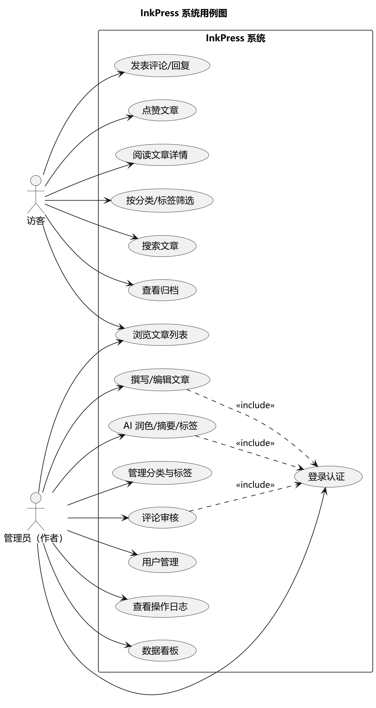

# 第3章 系统需求分析

## 3.1 可行性分析

在动手之前，先要回答"这个系统做不做得出来"的问题。本章从技术、经济、操作三个角度分别说明。

技术可行性方面，系统用到的技术都有成熟的文档和社区支持。Spring Boot 3.3、Vue 3、MySQL 8、Redis 7 都是目前企业开发的主流选择，遇到问题基本能通过官方文档和开源社区找到答案。开发机上 JDK 21、Maven、Node.js、Docker 都已具备，MySQL 和 Redis 用容器拉起即可，半天就能把环境准备好。真正需要花时间的是 AI 部分，但因为选择了 OpenAI 兼容协议，智谱、DeepSeek 等国内服务商都提供免费额度，接入成本比想象中低。

经济可行性方面，整个项目几乎不花钱。开发用的是开源软件，部署可以放在自己的电脑或一台低配云服务器上。AI 能力按调用量计费，个人写作场景的调用量每个月大概在几分钱到几块钱之间，智谱的 glm-4-flash 甚至有免费额度。学校没有要求购买任何商业组件。

操作可行性方面，系统的使用者分两类。对访客来说，打开网页就能看文章、评论、点赞，不需要任何学习成本。对作者来说，后台就是常见的表单加编辑器，发布文章的流程和用 WordPress 写博客差不多。作者本人具备基本的数据库和 Web 开发知识，日常维护（重启服务、备份数据库）有部署文档说明，不需要专职运维。

## 3.2 功能需求分析

系统的使用者分为访客和管理员两类。访客是不需要登录的使用者，主要行为是阅读和互动；管理员是博客作者本人，负责内容的生产和管理。用例设计如图 3-1 所示。

### 3.2.1 访客用例

访客的功能围绕"读"和"互动"展开。

浏览文章。这是最核心的用例，包括文章列表和详情。列表页按发布时间倒序排列，置顶文章排在最前，每页显示若干篇；详情页展示标题、正文、分类、标签、作者、发布时间、浏览量。访客可以按分类或标签筛选，也可以用关键词搜索标题。

阅读体验相关。详情页提供目录大纲，长文章可以直接跳转；页面底部提供上一篇、下一篇文章的入口；还有相关文章推荐，这是系统智能检索能力的一个应用场景。

互动行为。访客可以对文章点赞，同一访客对同一文章只能点赞一次，重复点赞计数不增加；可以发表评论，也支持回复别人的评论。游客评论需要填写昵称，邮箱选填；是否展示取决于后台的审核配置。

归档浏览。按年份分组的文章时间线，方便回看历史内容。

### 3.2.2 管理员用例

管理员的功能围绕"写"和"管"展开，都需要先登录。

内容生产。撰写文章使用 Markdown 编辑器，支持所见即所得；可以保存草稿，也可以直接发布。AI 写作辅助是本系统的特色功能，包括润色（流式输出）、生成摘要、推荐标签、续写、生成标题，共五项。文章管理列表支持按标题、状态、分类筛选，支持发布下架、置顶、删除。

内容管理。分类和标签的增删改查。删除有约束：分类下还有文章时不能删，标签还被文章引用时不能删，避免产生脏数据。评论管理支持审核通过或拒绝，以及删除。用户管理支持查看注册用户、重置密码、删除（不能删自己和管理员账号）。

数据看板。展示文章数、评论数、总浏览量、总点赞数，近七天的内容发布趋势，以及分类文章数分布。

其他。管理员操作会记录操作日志，包括操作人、模块、请求路径、参数、来源 IP 和耗时，便于事后追溯。

### 3.2.3 站内问答用例

这是一个面向访客的智能用例。访客在前台右下角打开问答面板，输入自然语言问题，系统检索站内文章，基于检索结果生成回答，并给出引用来源。如果站内没有相关内容，系统会明确告知，不会编造。

## 3.3 非功能需求分析

功能之外，系统还需要满足一些质量属性要求，这些要求在毕设答辩时同样会被问到。

性能方面。文章列表和详情是最高频的接口，要求单次响应在 200 毫秒以内。热门文章查询走 Redis 缓存，缓存五分钟；浏览量写入用 Redis 承接，定时任务每分钟回写数据库，避免高频写操作拖累 MySQL。语义检索面向的是数百篇文章的规模，全内存计算余弦相似度是毫秒级的，这个量级下不需要引入专门的向量数据库。

安全性方面。密码用 BCrypt 加密存储，任何角色都看不到明文。接口认证用 JWT，管理端接口按角色鉴权。内容安全上，Markdown 渲染前经过白名单净化，防止 XSS 攻击；评论内容做长度限制。游客的邮箱等联系方式不在前台暴露，只有管理端可见。

可用性方面。系统提供统一的错误响应结构，出错时返回可读的中文提示。AI 服务不可用（未配置或调用失败）时，其他功能不受影响，AI 接口返回明确的错误码。图片加载失败时，文章列表自动降级为编号占位图，不出现破图。

可维护性方面。后端按 Controller、Service、Mapper 分层，前端按页面、组件、API 封装组织。AI 模型通过适配层接入，更换服务商只改配置不改代码。数据库结构有设计文档，接口有在线文档（Knife4j），部署有 Docker Compose。

## 3.4 本章小结

本章分析了系统的可行性，梳理了访客、管理员和站内问答三类用例，明确了功能边界，同时给出了性能、安全、可用性、可维护性四个方面的非功能需求。这些结论将直接指导第 4 章的系统设计。
