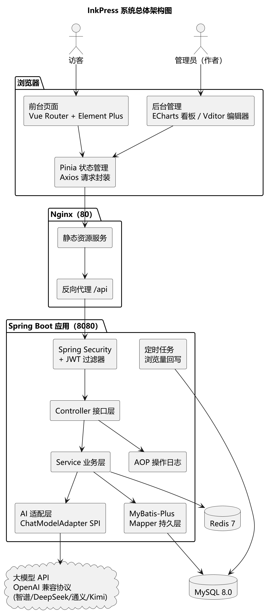
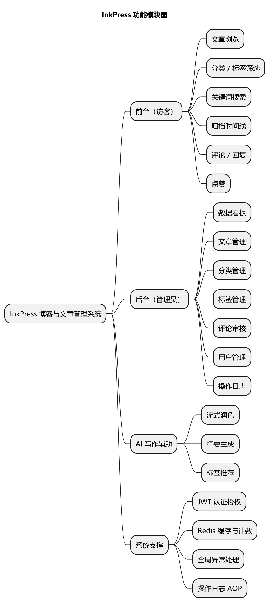
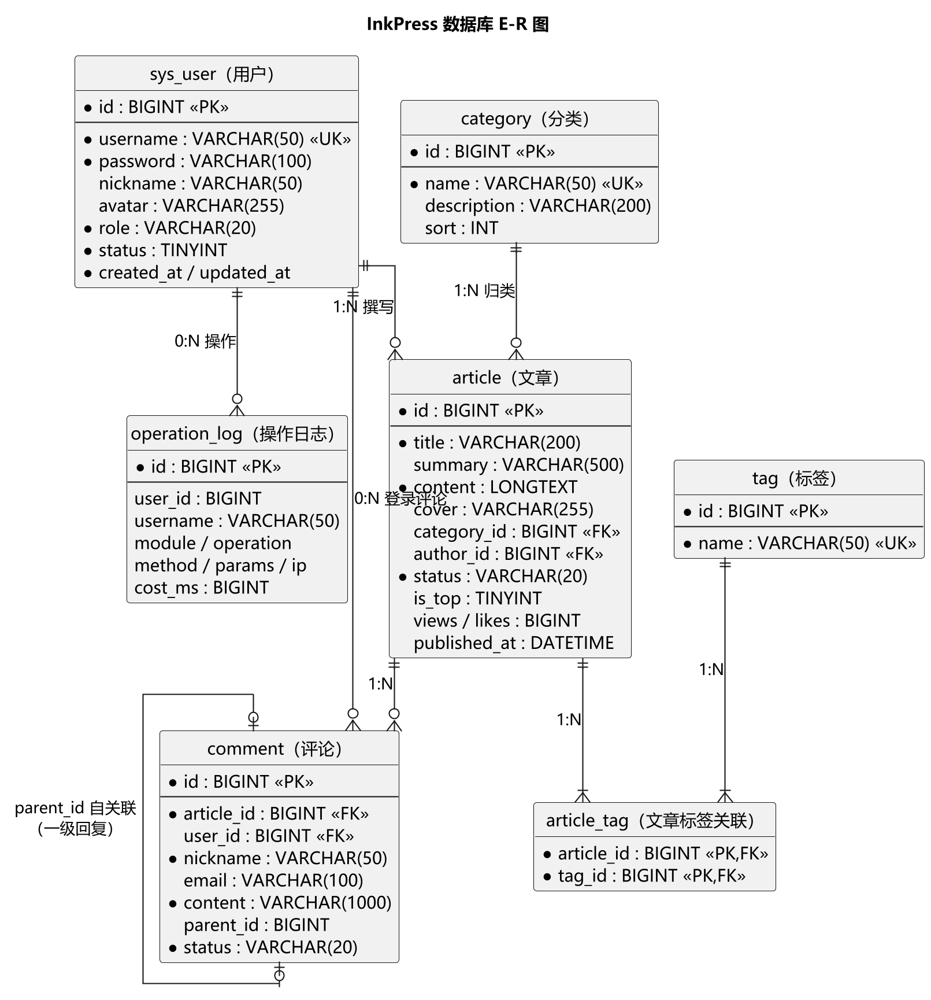

# 第4章 系统设计

## 4.1 总体架构设计

系统采用前后端分离架构，自底向上分为四层：数据层、服务层、接口层和展示层。总体架构如图 4-1 所示。

数据层由 MySQL 和 Redis 组成。MySQL 存储用户、文章、分类、标签、评论、操作日志等结构化数据，是系统唯一的数据权威来源。Redis 承担三类职责：热点文章列表的缓存、文章浏览量的计数缓冲、点赞去重集合，以及第 4.4 节要讲的语义向量索引。浏览量不直接写库，而是先在 Redis 中原子自增，由定时任务每分钟批量回写，把高频写操作挡在数据库之外。

服务层是 Spring Boot 应用的核心，按 Controller、Service、Mapper 三层组织。Controller 只做参数校验和结果封装，业务规则都在 Service 中，Mapper 通过 MyBatis-Plus 访问数据库。这一层还有三个横切关注点：Spring Security 加 JWT 过滤器负责认证鉴权，AOP 切面负责操作日志，定时任务负责浏览量回写。AI 能力以独立适配层的形式存在，对上层暴露统一的对话模型接口。

接口层对外提供 RESTful 风格的 HTTP 接口，统一返回 code、message、data 三段结构。接口文档由 Knife4j 自动生成，后端启动后访问 /doc.html 即可查看和调试。

展示层是 Vue 3 单页应用。前台面向访客，包括首页、文章详情、归档三个页面；后台面向管理员，包括登录、数据看板、文章编辑和若干管理页面。页面切换有过渡动效，Markdown 渲染、目录提取等逻辑封装为工具函数和组件。

前后端通过 Nginx 打通：静态资源由 Nginx 直接返回，/api 开头的请求反向代理到后端。开发环境下用 Vite 的 dev server 代理，行为与生产一致。

## 4.2 功能模块设计

系统功能分为前台、后台和智能检索三大部分，模块划分如图 4-2 所示。

前台模块服务访客。文章浏览模块处理列表、详情、分页和筛选；互动模块处理评论、回复和点赞；阅读增强模块提供目录大纲、上一篇下一篇、相关文章推荐和阅读进度，这些功能提升的是长文的阅读体验。

后台模块服务管理员。数据看板模块聚合统计指标和图表；文章管理模块覆盖撰写、编辑、草稿、发布、置顶的完整生命周期，编辑器内置 AI 写作辅助；内容管理模块处理分类、标签、评论审核；系统管理模块处理用户和操作日志。

智能检索模块是本文的重点设计内容之一，4.4 节单独展开。

## 4.3 数据库设计

### 4.3.1 E-R 图设计

数据库包含七张表，实体关系如图 4-3 所示。

关系说明：一个用户可以写多篇文章，一篇文章属于一个分类；文章和标签是多对多，通过 article_tag 关联表解耦，标签可复用、可统计；一篇文章有多条评论，评论通过 parent_id 自关联形成一层回复；用户的操作行为记录在 operation_log 中。

### 4.3.2 数据表设计

用户表（sys_user）存储账号信息，username 建唯一索引，password 是 BCrypt 密文，role 区分 ADMIN 和 USER 两种角色。文章表（article）是核心表，status 字段区分 DRAFT 和 PUBLISHED 两种状态，is_top 支持置顶，views 和 likes 是计数字段，published_at 用于列表排序和归档分组，这几个字段都建了索引。分类表（category）和标签表（tag）结构简单，name 各自唯一。文章标签关联表（article_tag）用文章 ID 加标签 ID 做联合主键。评论表（comment）的 status 有 PENDING、APPROVED、REJECTED 三态，对应审核流；article_id 和 status 建联合索引，因为前台查询总是"某篇文章的已通过评论"这个组合条件。操作日志表（operation_log）记录管理端写操作，created_at 建索引方便按时间回溯。

设计上有两个考虑值得一提。第一，计数字段放在业务表里而不是单独的表，因为个人博客的规模下没有必要拆分，Redis 已经挡掉了高频写；第二，评论邮箱是选填的联系方式，只存库、不在前台接口返回，这个细节在编码实现时通过 VO 转换保证。

## 4.4 智能检索模块设计

本节内容是本文与一般博客系统的区别所在。传统的"相关文章"多按同标签取最新几篇，搜索也只是标题模糊匹配。本系统把文章内容向量化，用语义相似度替代字面匹配，并在此基础上构建检索增强生成（RAG）问答。

### 4.4.1 向量模型选型

把文本映射为向量有三种常见路线，选型时对比如表 4-1 所示。

表 4-1 向量模型选型对比

| 方案 | 原理 | 优点 | 缺点 |
|------|------|------|------|
| 商用 Embedding API | 大规模语料预训练的深度模型 | 语义精度高，开箱即用 | 按调用计费；依赖外部服务 |
| 本地部署向量模型 | 自托管开源模型（如 BGE） | 精度接近商用 | 需要 GPU 或较大内存，部署重 |
| 特征哈希向量 | 字符 bigram 统计后哈希分桶 | 零依赖、零成本、毫秒级 | 无语义泛化，精度有限 |

本系统的取舍是：两者都要，但用接口隔离。定义 EmbeddingProvider 接口，提供两个实现——OpenAiCompatibleEmbeddingProvider 对接远程 API，HashingEmbeddingProvider 做本地计算。配置项 auto 模式下，有 API Key 时自动走远程，没有则降级到本地。这样设计的好处是开发和无 Key 环境下功能完整可用，配置 Key 后检索精度自动提升，而业务代码一行不用改。

### 4.4.2 特征哈希向量原理

本地向量的构建分三步。第一步是提取字符 bigram：对清洗掉标点和空白后的文本，取所有相邻两字符的组合，例如"动态规划"提取出"动态""态规""规划"三个 bigram。中文没有天然词边界，bigram 在一定程度上绕开了分词问题。第二步是哈希分桶：对每个 bigram 求哈希值，对维度取模映射到 512 维空间的一个桶，累加词频。第三步是归一化：词频先开方缓和长文优势，再做 L2 归一化，使向量模长为 1，余弦相似度退化为点积。

选 512 维而不是更高，是成本与效果的折中：个人博客语料几百篇，维度再高对检索质量提升不明显，反而让每篇文章的向量存储和计算量翻倍。

### 4.4.3 相关文章混合排序

相关文章如果只用语义相似度，会出现"内容很像但类型不同"的文章；只用标签重合，则找不出跨领域的关联。系统采用加权混合：

score = 0.85 × cosine(查询向量, 候选向量) + 0.15 × tagOverlap(查询标签集, 候选标签集)

其中 tagOverlap 是 Jaccard 系数，即交集大小除以并集大小。语义权重给到 0.85，因为内容相关性是"相关"的主要含义；标签权重 0.15 起微调作用，把同系列文章（比如同一个算法的多篇题解）聚拢。实验中发现这个比例下推荐结果的准确率和多样性都可以接受。

### 4.4.4 RAG 问答流程

RAG（检索增强生成）的核心思想是：不指望模型记住站内内容，而是在提问时先检索相关资料，把资料塞进提示词，让模型基于资料作答。流程分四步，如图 4-4 所示。

第一步，问题向量化。访客输入自然语言问题，用同一个 EmbeddingProvider 转为向量。

第二步，检索。计算问题向量与全库文章向量的余弦相似度，取 Top-4 文章，每篇截取正文前 600 字符。

第三步，拼装上下文。把检索结果按 [1][2][3][4] 编号拼接，连同问题一起发给大模型。系统提示词明确约束"仅依据提供的资料回答，资料不足就明说，不要编造"，并要求用编号标注信息来源。

第四步，流式生成与溯源。回答通过 SSE 逐段推送到前端；在正文开始前，先推送一条引用来源的 JSON 事件，前端据此渲染可点击的来源列表，读者点一下就能跳到原文。

这一步"先推来源、再推正文"的顺序是刻意设计的：读者第一眼就能看到回答依据的是哪几篇文章，可信度比光秃秃一段文字高得多。

### 4.4.5 索引更新策略

向量索引的时效性用三个机制保证。应用启动时异步全量重建，不阻塞启动流程，失败只记日志不影响主业务；文章发布或更新后，在保存事务中同步触发单篇的增量索引；文章下架或删除时，对应的 Redis 键被清理。索引存储在 Redis（键前缀 inkpress:emb:），设置 30 天过期，既是缓存也是兜底——即使索引丢了，重启也会重建。

## 4.5 接口设计

接口遵循 RESTful 风格，按资源划分。公开读接口包括文章分页、详情、热门、归档、分类列表、标签列表、评论查询，以及第 4.4 节的相关文章和语义搜索。公开写接口包括登录、注册、游客评论和点赞，其中点赞按登录用户或客户端 IP 去重。管理端接口统一挂在 /api/admin 前缀下，由 SecurityConfig 限定 ADMIN 角色，包括文章的增删改、分类标签维护、评论审核、用户管理和操作日志。AI 接口分两类：写作辅助（润色、续写为 SSE 流式，摘要、标签、标题为普通 JSON）挂在 /api/admin/ai 下；站内问答为公开 SSE 接口，因为读者也要用。

错误响应统一为 code、message、data 结构。业务错误码分段定义：1000 段是账号相关（用户名已占用、密码错误、账号禁用），2000 段是 AI 相关（未配置、调用失败、返回解析失败），其余复用 HTTP 语义。完整接口清单见附录文档。
