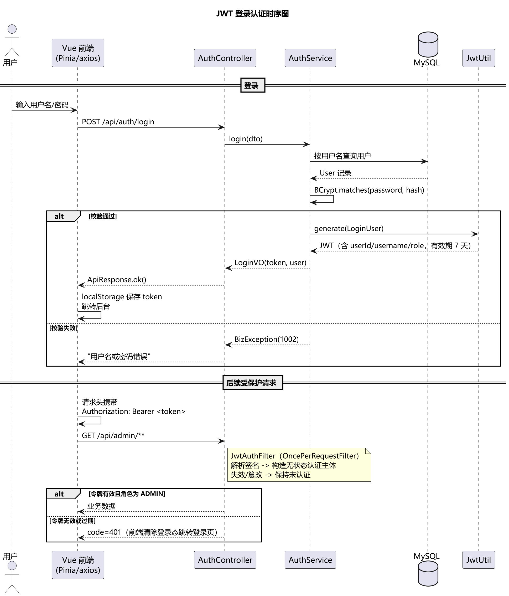
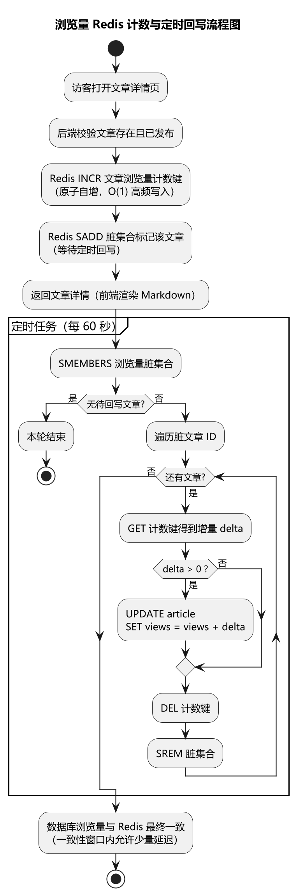

# 第5章 系统实现

## 5.1 开发环境搭建

后端开发使用 IntelliJ IDEA，通过 Maven 管理依赖，运行环境为 JDK 17（开发机为 JDK 21，兼容）。数据库和缓存用 Docker Compose 编排，一条命令即可拉起 MySQL 8.0 和 Redis 7，初始化脚本 db/init.sql 会自动建库建表并写入演示数据。前端使用 Node.js 20 与 VS Code，包管理用 npm。整个团队只有一个人，所以开发、测试、部署都在同一台机器上完成，环境一致性靠容器保证。

## 5.2 认证模块实现

认证是后台功能的入口，实现上由三个类协作完成。JwtProperties 读取配置文件中的密钥和有效期；JwtUtil 负责签发和解析令牌；JwtAuthFilter 是核心，继承 OncePerRequestFilter，在每次请求前从 Authorization 头中提取令牌并验证。关键代码如下：

```java
String header = request.getHeader("Authorization");
if (header != null && header.startsWith("Bearer ")) {
    try {
        LoginUser loginUser = jwtUtil.parse(header.substring(7));
        UsernamePasswordAuthenticationToken authentication = new UsernamePasswordAuthenticationToken(
                loginUser, null, List.of(new SimpleGrantedAuthority("ROLE_" + loginUser.getRole())));
        SecurityContextHolder.getContext().setAuthentication(authentication);
    } catch (JwtException | IllegalArgumentException e) {
        SecurityContextHolder.clearContext();
    }
}
chain.doFilter(request, response);
```

这段代码体现了无状态认证的处理思路：令牌合法就构造认证主体，不合法就清空上下文继续放行，后续的授权规则会决定这个请求能不能访问目标接口。之所以不直接返回 401，是因为公开接口（文章列表、详情等）本来就不需要认证，统一在 SecurityConfig 的请求匹配规则里区分。

令牌解析失败时抛出的异常被统一捕获，转换为 code=401 的 JSON 响应，前端据此清除登录态并跳转登录页。登录时序如图 5-1 所示。



密码存储使用 BCryptPasswordEncoder 加密，注册和管理员初始化的密码都经过编码后入库。首次启动时，AdminInitializer 会检查数据库中是否存在管理员账号，不存在则创建默认的 admin 账号，这个判断依据是"无 ADMIN 角色"而非"表为空"，避免先注册了普通用户后系统永远没有管理员的边界问题。

## 5.3 文章管理模块实现

文章模块是全系统最复杂的部分，涉及草稿、发布、置顶、删除四个操作，以及浏览量计数。

发布与草稿用同一个保存接口，通过 status 字段区分。保存逻辑上，新增时若指定了 publishedAt（补录历史文章的场景）则用之，否则取当前时间；编辑已发布文章时，发布时间不覆盖，保证归档时间线稳定。标签处理采用"按名查找、不存在则创建"的策略，用户在编辑器里输入新标签名直接回车就能用，不需要先去标签页建好。

浏览量是整个模块里最需要设计的一环。每次打开详情页都要计数，直接写数据库的话，热门文章会把数据库打满。实现分两段，写入时用 Redis 原子自增：

```java
stringRedisTemplate.opsForValue().increment(Constants.KEY_ARTICLE_VIEWS + id);
stringRedisTemplate.opsForSet().add(Constants.KEY_ARTICLE_VIEWS_DIRTY, id.toString());
```

同时把文章 ID 写进一个"脏集合"标记待回写。回写由定时任务每分钟执行，取出脏集合中的文章，把 Redis 里的增量值合并进数据库后清理计数键。流程如图 5-2 所示。



这个方案用一致性窗口换性能：一分钟内数据库里的浏览量是旧值，但读者看到的详情页读的是 Redis 计数，体验不受影响；即使进程崩溃，丢失的也只是一分钟内的增量。对博客场景，这个代价完全可以接受。

删除文章用事务保证原子性：文章、文章标签关联、该文章下的评论一并删除，避免残留孤儿数据。

## 5.4 AI 写作辅助模块实现

AI 模块的设计目标是"换厂商不改代码"。核心是 ChatModelAdapter 接口，只定义同步和流式两个方法，业务层只依赖这个接口：

```java
public interface ChatModelAdapter {
    String complete(List<ChatMessage> messages);
    void stream(List<ChatMessage> messages, ChatStreamHandler handler);
}
```

默认实现 OpenAiCompatibleAdapter 对接所有兼容 OpenAI 协议的服务。请求体按标准格式构造模型名、消息列表和温度参数，用 Bearer 令牌鉴权。智谱、DeepSeek、通义千问、Kimi 乃至本地 Ollama 都遵循这个格式，所以切换厂商只是改 application.yml 里的三个配置项：base-url、api-key、model。

流式输出是这个模块的技术难点。后端用 JDK 11 自带的 HttpClient 读取上游响应流，按行解析 SSE 数据块，提取增量文本后通过 Spring 的 SseEmitter 转发给浏览器：

```java
String payload = line.substring(5).trim();
if ("[DONE]".equals(payload)) { break; }
String delta = objectMapper.readTree(payload)
        .path("choices").path(0).path("delta").path("content").asText(null);
if (delta != null && !delta.isEmpty()) {
    handler.onDelta(delta);
}
```

前端用 fetch 加 ReadableStream 手动解析事件流。这里有一个坑：SSE 规范允许 data: 后面带一个可选空格，不处理的话润色后的正文每段开头都会多出一个空格。前端对两种情况都做了兼容：

```javascript
.map(line => (line.startsWith('data: ') ? line.slice(6) : line.slice(5)))
```

编辑器一侧，AI 润色和续写共用一套流式处理逻辑：累积增量文本，每 150 毫秒节流调用一次 Vditor 的写入接口，形成打字机效果；续写优先插入光标位置，降级方案是追加到文末。用户点"停止"按钮时，通过 AbortController 中断 fetch。

五项 AI 功能（润色、摘要、标签、续写、标题）共用提示词工程的三条经验：系统提示词把输出格式约束死（"直接输出，不要前缀"）、模型可能返回代码块包裹的 JSON 时做容错解析、解析失败返回空值而不是抛异常，保证 AI 抽风不阻断用户的保存操作。

## 5.5 智能检索与 RAG 模块实现

### 5.5.1 向量化实现

EmbeddingProvider 接口定义 embed 方法，两个实现按配置切换。本地特征哈希向量的核心代码只有二十行，却是整个检索模块的地基：

```java
// 字符 bigram 频率统计，哈希分桶
Map<Integer, Integer> buckets = new HashMap<>();
for (int i = 0; i < cleaned.length() - 1; i++) {
    String bigram = cleaned.substring(i, i + 2);
    int bucket = Math.floorMod(bigram.hashCode(), dim);
    buckets.merge(bucket, 1, Integer::sum);
}
// 词频开方缓和长文优势，再 L2 归一化
double norm = 0;
for (Map.Entry<Integer, Integer> e : buckets.entrySet()) {
    double w = Math.sqrt(e.getValue());
    vector[e.getKey()] = w;
    norm += w * w;
}
```

Math.floorMod 而不是取余运算符，是为了处理负数哈希值——String.hashCode() 完全可能返回负数，用 % 会得到负数下标直接越界。这个细节在调试时真实踩到过。

向量序列化为 JSON 数组存 Redis。选用 Redis 而不是内存 Map，有两个好处：服务重启后索引不丢，以及向量键设置 30 天过期，即使漏清理也会自然回收。

### 5.5.2 混合排序实现

相关文章的排序公式在 4.4.3 节给出，实现上对应 cosine 和 tagOverlap 两个私有方法。cosine 用通用公式而非直接点积，虽然向量已归一化，但通用写法对未归一化的输入也安全：

```java
private double cosine(double[] a, double[] b) {
    double dot = 0, normA = 0, normB = 0;
    for (int i = 0; i < Math.min(a.length, b.length); i++) {
        dot += a[i] * b[i];
        normA += a[i] * a[i];
        normB += b[i] * b[i];
    }
    double norm = Math.sqrt(normA) * Math.sqrt(normB);
    return norm > 0 ? dot / norm : 0;
}
```

切换向量实现后有个兼容性细节：如果本地是 512 维、远程是 1024 维，混存会导致维度不匹配。实现中对长度不一致的候选向量直接跳过，同时全量重建保证同批索引维度一致。

### 5.5.3 RAG 问答实现

RAG 的关键在于检索和生成两段解耦。IntelligentController 的 ask 方法先调用 vectorService.semanticSearch 取 Top-4 文章，每篇截取正文前 600 字符，拼装成带编号的上下文；然后通过 SSE 先推一条引用来源事件，再推流式正文：

```java
emitter.send(SseEmitter.event().data(sourcesJson));   // 先推引用
aiService.ask(dto.getContent(), knowledge.toString(), new ChatStreamHandler() {
    public void onDelta(String delta) {
        emitter.send(SseEmitter.event().data(delta));  // 再推正文
    }
});
```

前端 KnowledgeAsk 组件收到首条 JSON 事件后渲染可点击的来源标签，后续文本增量追加到回答区域。检索不到相关资料时（hits 为空），后端直接返回"站内暂无相关内容"，不调用模型——既省钱也避免模型胡说。

## 5.6 前台页面实现

前台是读者直接接触的部分，视觉上采用暗黑底加荧光色强调的作品集风格，与后台的低对比专业暗色区分开。三个页面的实现要点如下。

首页分 Hero 区和列表区。Hero 区展示站点定位和统计数字；文章卡片用 v-tilt 自定义指令实现鼠标跟随的 3D 视差倾斜，指令同时更新 CSS 变量驱动一层荧光光泽；标识行用 DecryptedText 组件做解密文字入场效果。列表卡片在没有封面图时，用后端返回的正文首图兜底，图片加载失败再降级为编号占位，三级降级保证版面不破。

详情页是阅读体验的核心。正文渲染链为 marked 转 HTML、DOMPurify 白名单净化、highlight.js 代码高亮。目录大纲组件从渲染后的 DOM 提取 h1 至 h3 标题动态生成锚点，滚动时高亮当前章节，点击跳转有 600 毫秒的高亮锁定，避免平滑滚动途中中间章节抢焦点。页面底部是上一篇、下一篇导航卡片和相关文章推荐区块，顶部有一条按阅读进度推进的荧光细线。

归档页按年份分组展示时间线，实现上直接消费后端返回的分组结构，前端只做渲染。

## 5.7 后台页面实现

后台页面基于 Element Plus 搭建，整体是低对比的暗色主题。数据看板用 ECharts 实现趋势折线图和分类分布饼图，色板选用沉静的灰蓝、橄榄色调，避免亮色在暗底上刺眼。文章编辑页集成 Vditor 编辑器（暗色主题），AI 功能按钮集中在工具栏，续写时有底部悬浮条显示状态和停止入口。分类、标签、评论、用户、日志六个管理页都是典型的表格加表单模式，删除操作统一走确认对话框，有引用约束的删除（分类下有文章）由后端返回业务错误码，前端以 ElMessage 提示。
