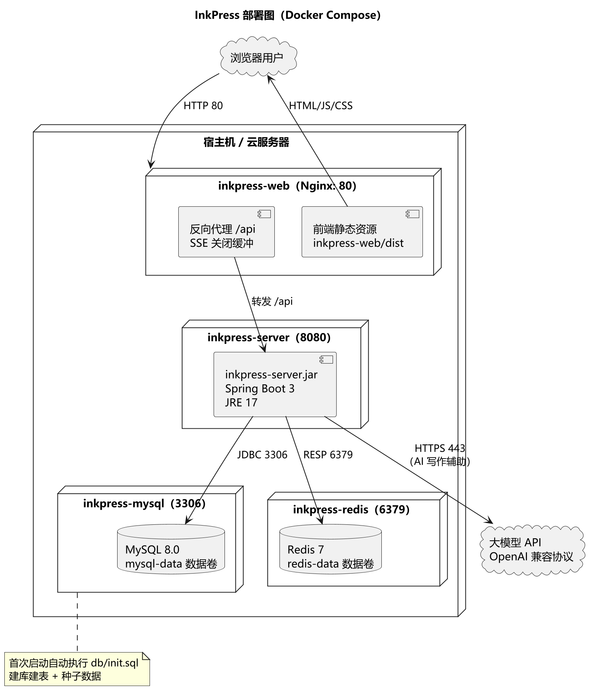
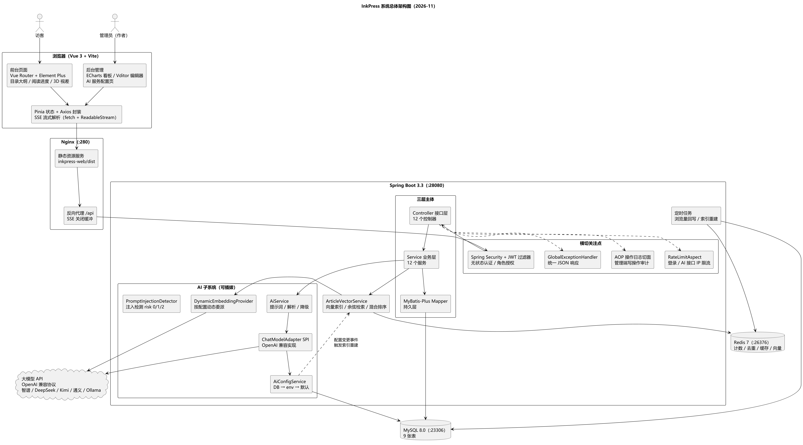
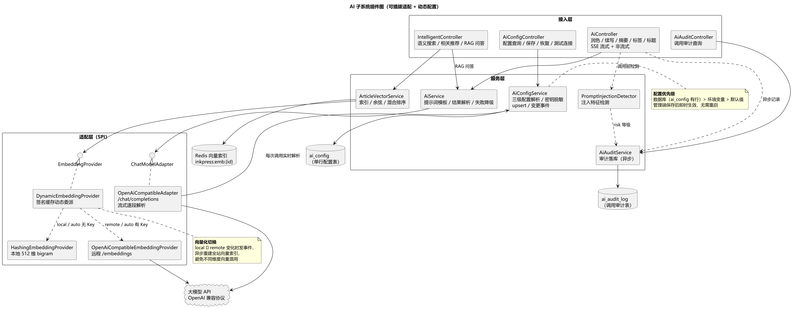
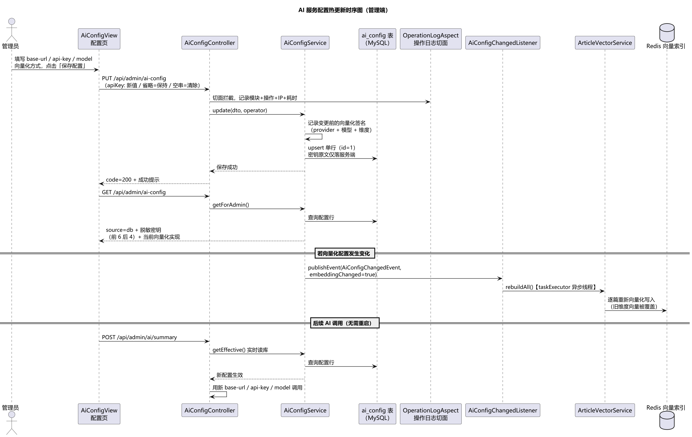
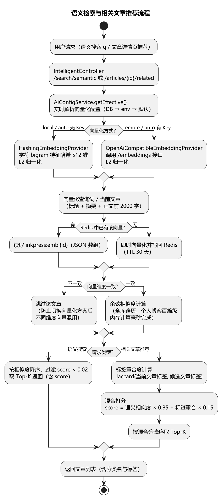

# InkPress 项目现状报告

> 报告日期：2026-11-06 · 视角：项目接管后的全面盘点
> 数据来源：本报告所有"已验证"结论均来自实际执行（编译、测试、接口调用、浏览器操作、文档渲染检查），非文档转述。

---

## 一、项目定位

| 项 | 内容 |
|---|---|
| 项目名 | InkPress · 墨记 |
| 性质 | 本科毕业设计（软件工程 · 2027 专升本） |
| 学生 / 学号 | 张德鑫 / 2505396 |
| 指导教师 | 王婧（副教授） |
| 题目 | 基于 Spring Boot+Vue 的个人博客与文章管理系统的设计与实现 |
| 一句话描述 | 数据自有的个人博客系统，前后端分离，内置 AI 写作辅助与站内语义检索/RAG 问答 |
| 代码仓库 | https://github.com/lggyx/inkpress（公开） |
| 毕设周期 | 2026.11 开题 → 2027.05 答辩，共 26 周 |

**与毕设进度表的对照**（按开题报告计划）：开题 ✅、需求分析 ✅、总体设计 ✅、编码实现 ✅（AI 功能待密钥实测）、联调测试与论文初稿 🔄 进行中。整体比原计划快约一个阶段。

---

## 二、总体架构

### 2.1 形态

前后端分离单体应用。Vue 3 SPA 经 Nginx 提供服务并反向代理 API；Spring Boot 3 单体后端按 Controller—Service—Mapper 三层组织；MySQL 存关系数据，Redis 承担缓存/计数/去重/向量索引；AI 能力经独立适配层接入，服务商参数由管理端在数据库中动态维护（热更新，无需重启）。

### 2.2 部署拓扑

{width=6.3in}

> 开发期端口统一加"2"前缀，避免与宿主机其他项目冲突。四个服务由 `docker-compose.yml` 编排。首次启动自动执行 `db/init.sql` 建库建表并写入种子数据。

### 2.3 后端架构（Java 17 + Spring Boot 3.3.5）

{width=6.3in}

请求自上而下流经：**横切关注点**（JWT 认证、角色授权、操作日志、限流、统一异常）→ **三层主体**（Controller 12 个 → Service 12 个 → MyBatis-Plus Mapper）→ 数据层；AI 请求额外经过 AI 子系统。12 个控制器：Auth / Article / Category / Tag / Comment / Dashboard / User / Log / Ai / AiConfig / AiAudit / Intelligent。

**AI 子系统**（差异点，独立设计）：

{width=6.3in}

| 组件 | 职责 |
|---|---|
| `ChatModelAdapter`（SPI） | 统一对话模型抽象；默认实现走 OpenAI 兼容协议，覆盖智谱/DeepSeek/Kimi/通义/Ollama |
| `AiService` | 提示词模板 + 结果解析 + 失败降级；润色/续写/RAG 问答走 SSE 流式 |
| `EmbeddingProvider`（SPI） | 本地 512 维 bigram 特征哈希 ↔ 远程 Embedding；`DynamicEmbeddingProvider` 按当前配置动态委派 |
| `PromptInjectionDetector` | 提示注入检测（risk 0/1/2），配合 `ai_audit_log` 落库 |
| `AiConfigService` | 配置三级解析：数据库 → 环境变量 → 代码默认值；密钥脱敏；变更事件驱动索引重建 |
| `ArticleVectorService` | 向量存 Redis，全内存余弦计算；相关文章 = 语义 0.85 + 标签重合 0.15 混合排序 |

### 2.4 前端结构（Vue 3 + Vite + Element Plus）

```
inkpress-web/src/
├── api/            10 个接口模块（axios 封装 + SSE 流式工具）
├── layouts/        FrontLayout（前台）/ AdminLayout（后台菜单）
├── router/         路由 + requiresAdmin 守卫
├── stores/         Pinia 登录态（同步 localStorage）
├── views/front/    首页 / 文章详情（目录大纲、阅读进度、3D 视差）/ 归档
├── views/admin/    看板 / 文章编辑（Vditor + AI 辅助）/ 分类 / 标签 / 评论
│                   / 用户 / AI 服务配置 / 操作日志 / 登录
└── directives/     v-tilt（3D 视差）
```

### 2.5 数据层

**MySQL 9 张表**：`sys_user`、`category`、`tag`、`article`、`article_tag`、`comment`、`operation_log`、`ai_audit_log`、`ai_config`（单行配置表）

**Redis 5 类键**：

| 键模式 | 用途 |
|---|---|
| `inkpress:views:{id}` + `:dirty` | 浏览量计数，定时任务每分钟批量回写 MySQL |
| `inkpress:liked:{id}` | Set 记录点赞者，同人去重 |
| `inkpress:hot:articles` | 热门文章缓存 |
| `inkpress:emb:{id}` | 文章向量（JSON 数组，TTL 30 天） |
| 限流窗口 | 登录 / AI 接口按 IP 计数 |

**线程池**：`taskExecutor`（4-8 线程，日志落库、索引重建）、`aiExecutor`（4-16 线程，AI 流式调用）

### 2.6 两条关键链路

**① AI 配置热更新**（管理端保存 → 即时生效，全程无重启；密钥原文只落服务端，接口脱敏回显）：

{width=6.3in}

**② 语义检索与相关推荐**（查询向量化 → 全库余弦 → 混合排序；维度不一致自动跳过，防止切换向量化方案后混用）：

{width=6.3in}

> 全部 12 张工程图（PlantUML 源文件 + PNG/SVG）见 `docs/diagrams/`，论文插图可直接取用。

---

## 三、功能与验证状态对照

这是本报告最重要的一节——**区分"代码里有"和"实测过"**。

### 3.1 前台（访客）

| 功能 | 实现 | 验证方式 | 状态 |
|---|---|---|---|
| 文章列表/分页/筛选/搜索 | ✅ | 冒烟 + 接口调用 | ✅ 已验证 |
| 文章详情（Markdown 渲染、代码高亮、XSS 净化） | ✅ | 冒烟 + 安全用例 | ✅ 已验证 |
| 归档时间线、热门文章 | ✅ | 冒烟 | ✅ 已验证 |
| 评论（游客可评、回复、审核流） | ✅ | 冒烟（含待审核→可见链路） | ✅ 已验证 |
| 点赞（同人防重复） | ✅ | 冒烟（重复点赞计数不变） | ✅ 已验证 |
| 语义搜索 / 相关文章推荐 | ✅ | 冒烟 + 基准测试 + 论文实验（5 组 Top-1 全命中） | ✅ 已验证 |
| RAG 站内问答（引用溯源、空检索不调模型） | ✅ | 代码审查 + 基准测试 | ⚠️ 链路已验证，**依赖 Key 的端到端未测** |

### 3.2 后台（管理员）

| 功能 | 实现 | 验证方式 | 状态 |
|---|---|---|---|
| 登录认证、角色授权、越权拦截 | ✅ | 冒烟 + 安全测试（401/403） | ✅ 已验证 |
| 数据看板（总量、7 天趋势、分类分布） | ✅ | 冒烟（与库中数据核对） | ✅ 已验证 |
| 文章管理（草稿/发布/置顶/删除级联） | ✅ | 冒烟（含草稿前台 404） | ✅ 已验证 |
| 分类/标签管理（删除前引用校验） | ✅ | 冒烟 + 功能用例 | ✅ 已验证 |
| 评论审核、用户管理、操作日志 | ✅ | 冒烟 + 功能用例 | ✅ 已验证 |
| **AI 服务配置管理（新增）** | ✅ | 9 项 Java 测试 + 10 项 API 语义 + 浏览器端到端 | ✅ 已验证 |

### 3.3 AI 写作辅助——**当前最大缺口**

| 功能 | 实现 | 验证状态 |
|---|---|---|
| 流式润色（SSE 打字机效果） | ✅ 代码完整 | ❌ **待 API Key 实测**（测试报告 C-02） |
| AI 生成摘要 | ✅ 代码完整 | ❌ **待实测**（C-03） |
| AI 推荐标签 | ✅ 代码完整 | ❌ **待实测**（C-04） |
| AI 续写 / 标题生成 | ✅ 代码完整 | ❌ **待实测** |
| 切换模型服务商 | ✅ 配置化 + 管理端热切换 | ❌ 切换链路已验，**模型侧未实测** |
| 未配置 Key 的降级行为 | ✅ | ✅ 已验证（返回 code=2001 明确提示，不崩溃） |

> **诚实结论**：AI 五项功能代码链路完整、降级行为已验证，但从未用真实 Key 跑通一次完整调用。这是答辩前必须补齐的一环——管理端「AI 服务配置」页的"测试连接"按钮就是为这一步准备的。

### 3.4 安全

| 项 | 状态 |
|---|---|
| JWT 认证 + 篡改拦截 | ✅ 已验证 |
| 角色授权（管理端 401/403） | ✅ 已验证 |
| SQL 注入（参数化查询） | ✅ 已验证 |
| XSS（DOMPurify 白名单 + Vue 转义） | ✅ 已验证 |
| 提示注入检测 + 审计落库 | ✅ 已验证（risk=2 记录实测） |
| 登录暴力破解限流 | ✅ 已验证（同源第 6 次内 429） |
| AI 密钥脱敏（不落前端） | ✅ 已验证 |

---

## 四、测试体系

| 层级 | 内容 | 数量 | 状态 |
|---|---|---|---|
| Java 测试（`mvn test`） | Redis 基准 / 安全流程 / 语义检索基准 / AI 配置管理 | 14 | ✅ 全过 |
| 接口冒烟（`scripts/smoke-test.ps1`） | 认证/文章/评论/点赞/边界/检索/AI 降级 | 26 断言 | ✅ 全过 |
| 过程材料校验（`scripts/forms/verify_kaiti_docx.py`） | 开题报告 docx：模板残留/空节/文献唯一性/表格/元数据/目录页码 | 40+ 断言 | ✅ 全过 |
| 浏览器端到端 | 登录 → AI 配置保存 → 脱敏回显 → 恢复默认 | 1 条主链路 | ✅ 通过 |
| 视觉验收 | 开题报告 9 页、开题 PPT 11 页逐页检查 | 20 页 | ✅ 通过 |

> 说明：现有 Java 测试以**联机测试 + 基准测试**为主（需要后端跑在 28080），没有 Service 层纯单元测试（Mockito）。对毕设而言够用，但论文测试章节若写"单元测试"需斟酌口径。

---

## 五、文档资产

| 文档 | 状态 | 备注 |
|---|---|---|
| 开题报告（md 内容源 + docx + PDF） | ✅ 已重建 | 原 docx 有模板残留/文献错位等 8 类缺陷，已修复并 40+ 项校验 |
| 开题答辩 PPT（11 页 + 演讲者备注） | ✅ 已验收 | PDF 已同步为当前版本 |
| 毕业论文（10 章 md + docx） | ⚠️ 待更新 | 未反映 ai_config 表与配置管理设计（第 4/5 章） |
| 中期报告（docx + PDF） | ✅ 已修复 | 同类模板缺陷已清 |
| 过程材料 7 份（任务书/检查表/小结/周记录/答辩记录） | ✅ 已归档 | 位于 `docs/过程材料/`，生成链一键复现 |
| 接口文档 / 数据库设计 / 测试报告 | ✅ 已同步 | 含新增的 AI 配置接口与表 |
| 工程图（12 张 PlantUML，PNG/SVG 双格式） | ✅ 已更新 | 架构图/ER 图已反映 ai_config、ai_audit_log、动态向量化；新增 AI 组件图、配置热更新时序图、语义检索流程图 |
| 调研数据（8 维度，A 级实数 + 本地实测） | ✅ | `docs/research/` |

---

## 六、已知问题与风险清单

按优先级排列，**诚实列全**：

### P0（影响交付，必须处理）

1. **AI 五项功能未用真实 Key 实测**——论文核心创新点目前只有代码和降级验证。答辩若被要求现场演示，当前状态会落空。**需要：API Key（等用户提供）→ 配置页填入 → 测试连接 → 五项实测 → 回填测试报告。**
2. **论文第 4/5 章未反映 AI 配置管理**——数据库设计（9 张表 vs 论文里的表数）、系统实现章节都缺这块内容，论文与代码不一致。

### P1（影响质量，建议处理）

4. **git 历史中仍有学校过程材料**——虽然已取消跟踪，但公开仓库（github.com/lggyx/inkpress）的历史里能看到学校模板和 1.9MB 文件包。彻底清除需要重写历史 + 强推（不可逆，需用户决策）。
5. **任务书与开题报告口径差异**——签字版任务书（2026-10）设计时间写"2026.11.23–2027.1.18"、参考文献是另一套；开题报告（2026-11）是 26 周计划和 12 条文献。答辩时可能被问，需要统一说法。
6. **无 Service 层单元测试**——现有为联机/基准测试。

### P2（优化项）

7. 前端主 chunk 约 1.2MB（gzip 391KB），ECharts/Vditor 可按需优化。
8. Spring Boot 3.3.5 已过 OSS 支持期（选型时点稳定版，论文已有答辩口径）。

---

## 七、接管后已完成的工作（2026-11-06）

| # | 工作 | 结果 |
|---|---|---|
| 1 | 全链路盘点（编译/测试/冒烟/构建/权限/接口清单） | 摸清真实状态，发现文档声称与代码基本一致 |
| 2 | **重建开题报告 docx** | 修复 8 类缺陷（模板残留、文献两套、空节、目录页码、元数据等），md 重构为学校模板 8 节骨架，新增 40+ 项校验 |
| 3 | 修复中期报告 docx 同类缺陷 | 清洗 + 目录回填 |
| 4 | 开题 PPT 验收 + PDF 同步 | 11 页逐页视觉检查通过 |
| 5 | 文档与代码一致性核对 | 26 项断言口径纠正（我此前口误 27，实际 26） |
| 6 | 仓库卫生整顿 | 学校材料/脚本/数据重新归位，122 个文件变动已暂存 |
| 7 | **AI 配置管理功能**（按用户决策：数据库 + 管理端） | 9 张表之外新增 ai_config，12 个新 Java 文件 + 前端配置页，密钥脱敏/操作审计/索引自动重建，全链路实测通过 |
| 8 | **工程图更新到当前架构** | 12 张 PlantUML 图纸（更新 3 张 + 新增 3 张），PNG 200dpi + SVG 双格式渲染，本报告插图全部改用真实图纸 |

---

## 八、待办与建议优先级

| 优先级 | 事项 | 阻塞条件 |
|---|---|---|
| **P0** | AI 五项功能实测（C-02~C-05）+ 回填测试报告 | 等用户提供 API Key |
| **P0** | 论文第 4/5 章补充 ai_config 表与配置管理设计 | 无（可立即做，需用户确认口径） |
| P1 | git 历史清洗决策 | 需用户决策（不可逆） |
| P1 | 任务书/开题报告口径统一说法 | 需用户决策 |
| P2 | Service 层单元测试补充 | 无 |
| P2 | 前端包体优化 | 无 |

---

## 九、快速运行指南

```bash
# 1. 基础设施（已运行中）
docker compose up -d mysql redis          # MySQL :23306，Redis :26376

# 2. 后端
cd inkpress-server && mvn spring-boot:run  # :28080，文档 /doc.html

# 3. 前端
cd inkpress-web && npm install && npm run dev   # :25173

# 4. 登录
后台 http://localhost:25173/login → admin / admin123

# 5. 配置 AI
后台 → AI 服务配置 → 填入 API Key → 测试连接 → 保存（即时生效）
```

**测试命令**：

```bash
mvn test                                    # 14 项 Java 测试（需后端在跑）
powershell -File scripts\smoke-test.ps1     # 26 项冒烟断言
powershell -File scripts\forms\build_forms.ps1   # 过程材料一键生成 + 校验
```

---

## 十、关键文件索引

| 想知道什么 | 看哪里 |
|---|---|
| 项目总览 | `README.md` |
| 架构细节 | 本文档 + `docs/diagrams/*.puml` |
| 接口清单 | `docs/接口文档.md` 或 `/doc.html` |
| 数据库 | `docs/数据库设计.md` + `inkpress-server/src/main/resources/db/init.sql` |
| 测试 | `docs/测试报告.md` + `inkpress-server/src/test/java/com/inkpress/benchmark/` |
| AI 配置实现 | `inkpress-server/.../service/impl/AiConfigServiceImpl.java` + `.../ai/DynamicEmbeddingProvider.java` |
| 过程材料生成链 | `scripts/forms/README.md` |
| 论文 | `docs/论文/`（10 章 md + docx） |
| 调研数据 | `docs/research/` |

---

*本报告由项目接管盘点生成；所有验证结论可复现（命令见第九节）。*
